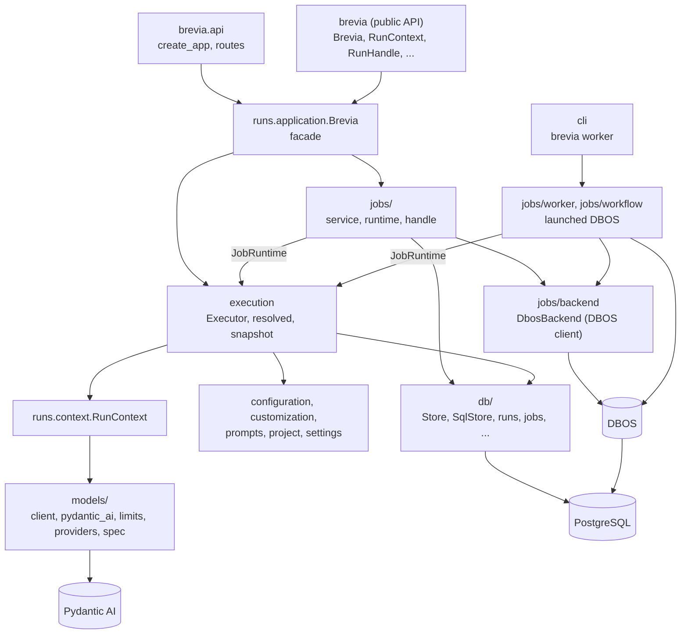
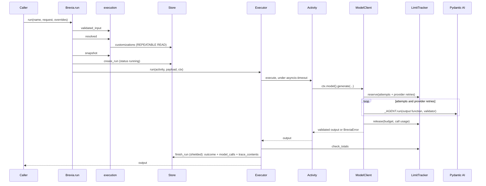
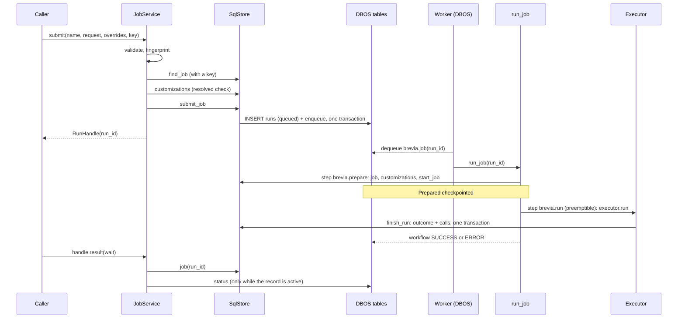
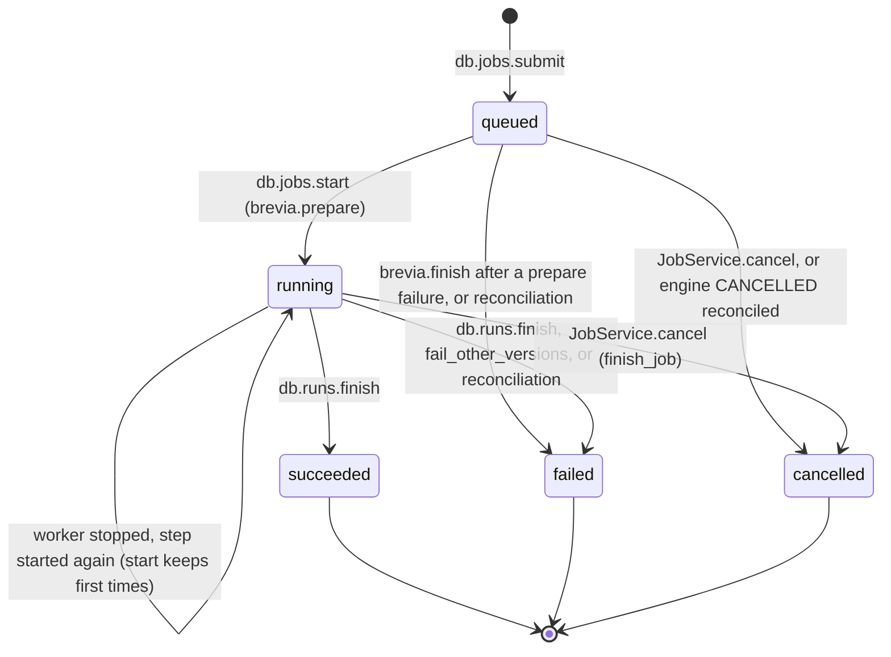

# Architecture

This page is for whoever changes Brevia: it shows how the package is organised, how a
direct run and a job flow through the modules, who writes each record, and the
invariants a change must keep. How to *use* the library is in the guides. Names such as
`runs.execution.Executor.run` are modules and functions under `src/brevia/`; test names are
under `tests/`.

The page describes the code on `main`. What is planned is marked as such and listed in
the [implementation status](IMPLEMENTATION.md).

## Map of the package

| Module | Responsibility |
|---|---|
| `__init__` | The public API: exactly what `__all__` lists, with the `__all__` of `brevia.analysis`, `brevia.tools`, `brevia.api` and `brevia.testing`. Everything else is internal |
| `runs/application` | `Brevia`, the facade: lifecycle (`start`, `stop`, `check`), activity registration, `run`, `submit`, `job`, `jobs`, `find_job`, `add_feedback`, customisation methods. It builds the `Executor`, the `JobRuntime` and the `JobService` and wires them together |
| `runs/activities` | The `Activity` dataclass, `Mode` (`direct`, `job`), `Capture` (`metadata`, `full`) and the name pattern |
| `config/project` | `ProjectSettings` and `load_project`: the TOML project file (models, limits, activity defaults, `[traces]`) |
| `access/access` | `Caller`: the application that asks for an operation, with the end user it acts for; `AccessPolicy`: which jobs a caller sees and who changes customisations |
| `access/auth` | `Authenticator`, `AuthSettings`, `create_token`: JWT as in Brevia 0.15 (PyJWT) |
| `files/files` | `FileSource`, `FileRef`, `FileStore` (folder and accepted inputs), `RunFiles` (`ctx.files`: download or copy with checks, a path reserved per source before any wait, atomic save, `close` that waits for its threads), `check_sources` at submission (after the lookup by key for jobs), filter of the URLs logged by `httpx2` |
| `files/documents` | `read_document`, `Document`, `Section`, `split`, `Piece`: text of PDF, DOCX and text files and its pieces |
| `config/settings` | `BreviaSettings`: installation settings from `BREVIA_*` variables and `.env` |
| `config/configuration` | Pure functions that compose a configuration: `resolve`, `compose`, `check_overrides`, `check_customization` |
| `config/customization` | Public states (`ConfigurationState`, `PromptState`, `PromptRevision`) and the rules of customisations: `stored_customization`, `effective_prompts`, `updated_values`, `reset_values` |
| `config/prompts` | `PromptTemplate` and `load_prompt`: prompt files with declared variables |
| `config/defaults` | Every functional default of the library (output tokens, attempts, run limits, `summarize` and `extract` settings, trace retention), public as `brevia.config.defaults` |
| `runs/feedback` | `FeedbackRequest`, `Correction`, `Feedback`: corrections or a rating added to a run |
| `runs/context` | `RunContext`: what an activity receives besides its input; built from the snapshot, it owns the run's `LimitTracker` and its `RunFiles` |
| `runs/execution` | Steps shared by direct runs and jobs: `validated_input`, `resolved`, `snapshot`, `recorded_*`, `execute` (the deadline) and `Executor` (runs a prepared activity and records its outcome) |
| `models/spec` | `ModelSpec`, `ModelInfo`, `Prices`, `check_capabilities` |
| `models/limits` | `RunLimits`, `CallUsage`, `Usage`, `LimitTracker` (reservations, totals, time left) |
| `models/client` | `ModelClient.generate` and the sequence of a call: reservation, provider retries, usage and limits; `GenerationRequest`, `GenerationOutcome`, `estimate_cost` |
| `models/pydantic_ai` | The Pydantic AI adapter: `attempt` runs one stateless agent with an output function that calls the validator, and translates Pydantic AI errors |
| `models/providers` | Provider clients shared per event loop, with SDK retries off; `hold_providers`, `release_providers` |
| `db/store` | `Store` protocol (the operations the application needs) and `SqlStore` (PostgreSQL, one short transaction per operation) |
| `db/runs` | Rows of `runs` at start (`create`) and end (`finish`), `model_calls` and `trace_contents` (`insert_calls`) |
| `db/jobs` | Rows of jobs in `runs`: `submit`, `read`, `find`, `page`, `start`, `finish` |
| `db/feedback` | Rows of `feedback`, only inserted: `owner` (the caller of a run), `add` (with the idempotency key), `find` |
| `db/customizations` | `configurations`, `prompts`, `prompt_revisions`, with row locks and versions |
| `db/cleanup` | Clearing of expired `trace_contents`, in batches |
| `db/tables` | SQLAlchemy table definitions in the placeholder schema `brevia` |
| `db/engine` | Async engine (pool, statement timeout, schema translation) and sync engine for migrations |
| `db/migrate`, `db/migrations/` | Alembic for the Brevia schema; `upgrade_jobs` migrates the DBOS schema |
| `db/values` | `recordable_json`, `storable_json`, `without_nul`: values PostgreSQL accepts |
| `jobs/service` | `JobService`: submission, state, result, cancellation, retry, reconciliation with the engine (`engine_ending`) |
| `jobs/handle` | Public `RunHandle` and `JobState` |
| `jobs/runtime` | `JobRuntime`: the only view of a `Brevia` instance that the job modules use |
| `jobs/backend` | `JobBackend` protocol and `DbosBackend` (DBOS client: enqueue, cancel, status, delete); filter of the engine's log records |
| `jobs/workflow` | The DBOS workflows `run_job` and `run_cleanup` and their steps |
| `jobs/worker` | `serve`, `launch`, `fail_other_versions`: the `brevia worker` process |
| `files/retention` | `clean`: daily deletion of expired contents, of steps of ended jobs and of expired folders of files (`FileStore.clean`) |
| `cli` | The `brevia` command: `db upgrade`, `db current`, `db cleanup`, `worker`, `token create` |
| `testing` | `fake_model`: fake models for the tests of a project |
| `models/fake` | The fake model installed by `fake_model` and `BREVIA_FAKE_MODELS`, used by `_model_for` |
| `errors` | Error catalogue, `error_from_dict`, `validation_details`, `cause_types` |
| `runs/logs` | `configure_logging`, text and JSON formatters carrying `run_id`, `activity` and `request_id` |
| `api/app` | `create_app`: the FastAPI app with the lifespan of `Brevia`, the request identifier, the error handlers, the routers and the OpenAPI document |
| `api/requests` | What every endpoint uses: `BreviaDep`, `CallerDep` (the caller of the Bearer token), `acting_for` (the `end_user` of a body), `ErrorBody` and `error_response` |
| `api/routes/health` | `/health/live`, `/health/ready` and `/status` |
| `api/routes/activities` | `/activities`: the registered activities and their schemas |
| `api/routes/runs` | `/runs`: direct runs, jobs (state, list, result, cancel, retry, output files) and feedback |
| `api/routes/configurations` | `/configurations` and `/prompts`: read, customise, reset |

### Layers

- Direct runs and jobs share one `Executor`, created by `Brevia.__init__`.
- The job modules receive a `JobRuntime` (project, store, executor, backend, activity
  lookup, `check_started`) instead of reading private attributes of `Brevia`. The
  worker reads `app._job_runtime` in one place, `jobs.worker._runtime`.
- DBOS is imported by `jobs/backend`, `jobs/workflow`, `jobs/worker` and by
  `db/migrate` (only for `DBOS.migrate` in `upgrade_jobs`). `jobs/workflow`, which
  registers the DBOS workflows, is imported only by `jobs/worker`.
- Pydantic AI is imported only by `models/pydantic_ai` and `models/providers`;
  `models/client` uses its usage counters through `models.pydantic_ai.Usage`.
- `db/runs` uses `models.limits.CallUsage`, and `models/client` uses `db.values` to
  make captured outputs storable.

## A direct run, step by step

`Brevia.run(name, request, overrides)` in `runs/application.py`:

1. **Checks.** `_check_started`, `_activity(name)` (`NotFound`), `"direct"` in its
   modes (`Unsupported`).
2. **Input.** `runs.execution.validated_input` builds the input model. A
   `ValidationError` becomes `InvalidInput` with `validation_details` and `from None`,
   so the input values are not printed by a traceback.
3. **Configuration and prompts.** `runs.execution.resolved` calls
   `store.customizations(activity)`. `SqlStore` reads the configuration and the prompts
   in one `REPEATABLE READ` transaction, so they come from the same moment. It never
   caches them. `config.customization.stored_customization` checks the stored values against
   the current code (`Unavailable` if no longer valid). `config.configuration.resolve` composes
   defaults, customisation and overrides. `config.customization.effective_prompts` picks the
   file or the stored text.
4. **Snapshot.** `runs.execution.snapshot` builds the record of the values used:
   `format`, application version (`Brevia.app_version`), activity, configuration by
   alias, model overrides, prompts with text, source, hash and version, the project's
   models, limits, adapter, library and capture.
5. **Record of the start** (when `record_direct_runs`). `store.create_run(NewRun(...,
   mode="direct"))` inserts a `running` row through `db.runs.create`, in its own
   transaction. `recorded_input` and `recorded_snapshot` refuse values without a
   finite JSON form (`InvalidInput`).
6. **Context.** `RunContext(run_id, config, snapshot)` is created *after* that write,
   so waiting for a connection does not consume the run's time. Its `LimitTracker`
   starts the clock.
7. **Execution.** `Executor.run(activity, payload, ctx, overrides, record=...)`:
    - `execute` runs the function under `asyncio.timeout(tracker.seconds)`, and checks
      the elapsed time again on return (blocking code cannot be interrupted);
    - `tracker.check_totals()` catches a limit that the activity swallowed;
    - `checked_output` checks the type (`InternalError` otherwise);
    - `recorded_output` makes it JSON;
    - `record(ctx, "succeeded", result=...)` writes the outcome.
8. **Outcome write.** `Executor._shielded_write` runs `store.finish_run(outcome)` in a
   task kept in `Executor._writes` and awaited through `asyncio.shield`.
   `db.runs.finish` updates the row and inserts the calls (`insert_calls`) in **one
   transaction**. The output is returned only after the write succeeded.

### Inside a model call

`ctx.model()` builds a `ModelClient` from the configured `model` field, the per-call
override and the request's model overrides (which prevail), checked against the
project's `ModelInfo`. `ModelClient.generate`:

1. `LimitTracker.reserve(max_attempts + provider_retries)` reserves requests at once,
   so concurrent calls in one run cannot spend the same budget. It raises `RunTimeout`
   or `LimitExceeded` when nothing is left. Tokens cannot be reserved: each call gets
   the tokens left when it starts.
2. `generate_once` loops over `models.pydantic_ai.attempt`, which runs the shared stateless
   `_AGENT` with an output function (`_output_function`) that validates the type and
   then calls the validator. Validator problems become `ModelRetry`, within
   `retries={"output": max_attempts - 1}` and `UsageLimits` from the reservation.
3. `attempt` translates Pydantic AI errors: `UsageLimitExceeded` to `LimitExceeded`,
   `UnexpectedModelBehavior` to `OutputInvalid` (reason `max_tokens`,
   `content_filter`, `incomplete_output` or `invalid_output`), `ModelHTTPError` and
   `ModelAPIError` to `ProviderError` with `cause_types` only.
4. A retryable `ProviderError` (5xx, 408, 409, 429, or no status) is retried up to
   `provider_retries` times, with exponential waits or `Retry-After`. It is not
   retried after the model already answered in that attempt, past the request limit,
   past `RETRY_AFTER_MAX_SECONDS`, or when the wait would leave less than
   `RETRY_MARGIN_SECONDS`. Each failed request counts as one.
5. In `finally`, `tracker.release(budget, call)` frees the reservation and adds the
   call's usage, also when the call is cancelled (`error="cancelled"`) or raises
   (`"internal"`). With `capture="full"`, `with_content` attaches instructions, user
   text and output.
6. After the call: `tracker.seconds_left()` turns a passed deadline into `RunTimeout`.
   Then the call's own error is raised. Then `check_totals()` discards the output of a
   call that, with concurrent ones, went over the tokens or tool calls.

### Errors, cancellation, timeout

| What happens | Where | Recorded as | Raised to the caller |
|---|---|---|---|
| A `BreviaError` (for example `OutputInvalid`, `LimitExceeded`, `RunTimeout`) | `Executor.run`, `except BreviaError` | `failed` with `exc.to_dict()` | The same error. If the write fails, `Unavailable`, with the run error as its context |
| Any other exception | `Executor.run`, `except Exception` | `failed` with an `InternalError` naming the type | `InternalError ... from None`, raised outside the handler so that neither it nor a write failure carries the original message |
| Deadline passes in an async wait | `runs.execution.execute` (`asyncio.timeout`) | `failed`, `RunTimeout` | `RunTimeout` |
| Deadline passes in blocking code | `execute`, elapsed time checked on return | `failed`, `RunTimeout` | `RunTimeout` |
| Deadline passes during a model call | `ModelClient.generate`, `tracker.seconds_left()` | `failed`, `RunTimeout` | `RunTimeout` |
| The caller's task is cancelled | `Executor.run`, `except asyncio.CancelledError`, then `record_cancelled` | `cancelled` (direct runs only, see `db.runs.finish`) | `CancelledError`. A failed write is logged with `cause_types` only, and does not replace the cancellation |
| The caller is cancelled again during the outcome write | `_shielded_write` | The write goes on; a later failure is logged by its done callback | `CancelledError` |
| The outcome cannot be written after success | `Executor.record` | Row stays `running` | `Unavailable`; the output is **not** returned |
| `Brevia.stop()` while runs are in progress | `stop` sets `_started = False`, then `Executor.drain()` awaits writes under way | Runs that end later cannot write (`Unavailable`: store not started) | `Unavailable` |
| The process dies | — | Row stays `running`; usage lost | — (direct runs are not durable) |

## A job, step by step

### Submission

`Brevia.submit` calls `JobService.submit(name, request, overrides, idempotency_key)`:

1. The activity must have the `"job"` mode (`Unsupported`). `check_key`: non-blank,
   at most `MAX_KEY_LENGTH` (200), without NUL (`runs/execution.check_key`, shared with
   feedback).
2. `validated_input`, then `recorded_input`, then `validated_input` again on the JSON
   form: the worker validates the recorded input, so it must still be valid.
3. Overrides must pass `recordable_json` (`InvalidInput` otherwise): the worker
   resolves them again from the record.
4. `fingerprint` = SHA-256 of canonical JSON of activity name, version, input and
   overrides.
5. With a key, `store.find_job` first. An existing job is returned if the fingerprint
   matches, else `IdempotencyConflict`. This does not depend on the configuration now.
6. `runs.execution.resolved(store, activity, overrides)` checks that the job *can* resolve
   now. The result is discarded: the worker resolves again.
7. `store.submit_job(NewJob, enqueue)`. `db.jobs.submit` inserts the `queued` row
   (`ON CONFLICT DO NOTHING` on `(caller, activity, idempotency_key)`). It then calls
   `DbosBackend.enqueue(connection, run_id)`, which uses
   `DBOSClient.enqueue_in_transaction` **in the same transaction**. Workflow id =
   run id, queue `brevia_jobs`, workflow `brevia.job`, no application version. A
   concurrent submission with the same key waits on the unique index, then finds the
   winner (`created=False`, then `_found`).

### The worker

`brevia worker MODULE:NAME` (`cli._worker`) configures logging, imports the `Brevia`
object (or calls a function that returns it) and runs `jobs.worker.serve`:

1. `app.start()`: store, DBOS client (only if an activity has the `job` mode),
   providers.
2. `launch(app, backend, version, worker_id)`:
    - `workflow.install(runtime, version)` sets the module globals the workflow
      reads, the `JobRuntime` and the version the worker runs under;
    - creates `DBOS` with `application_version`, `executor_id = worker_id` and
      `run_migrations=False`;
    - `guard_engine_logs()`, `DBOS.launch()`;
    - `DBOS.set_latest_application_version(version)`, so that new jobs reach this
      worker also after a rollback.
3. `register_queue_async(QUEUE, worker_concurrency=...)` and `apply_schedules_async`
   with the daily `brevia.cleanup` (`CLEANUP_SCHEDULE = "0 3 * * *"`).
4. `fail_other_versions`. For each `PENDING` `brevia.job` of another application
   version, it calls `finish_job(..., "failed", InternalError(retryable))` **first**,
   then `backend.cancel`.
5. Wait for SIGINT, SIGTERM or the `stop` event. Then
   `DBOS.destroy(workflow_completion_timeout_sec=worker_shutdown_seconds)`,
   `_stop_running_jobs` (cancels remaining tasks; they record nothing),
   `workflow.install(None)` and `app.stop()`.

DBOS itself restarts, at launch, the `PENDING` workflows of the same `executor_id`
and `application_version`.

### The workflow `run_job`

`@DBOS.workflow(name="brevia.job", max_recovery_attempts=MAX_RESTARTS)`, with
`MAX_RESTARTS = 3`. Steps go through `_step(name, work, preemptible=...)`, which gives
DBOS a closure without arguments, so that DBOS never logs the arguments of a step.

1. **Step `brevia.prepare`** (`_prepare`):
    - `store.job(run_id)`: `None` if not active (cancelled meanwhile), and the
      workflow returns;
    - activity version equal to the recorded one (`_check_version`), else
      `Unsupported(retryable=True)`;
    - `validated_input` on the recorded input;
    - `resolved` with the recorded overrides, then `snapshot` with the worker's
      version;
    - `store.start_job(run_id, snapshot, now, now + max_seconds)`. `db.jobs.start`
      sets `running` and the snapshot, keeping `started_at` and `deadline_at` with
      `coalesce`;
    - returns `Prepared(payload, config, overrides, snapshot, deadline)`. DBOS
      checkpoints it by pickling, which is why `register_activity` refuses job types
      defined inside a function (`_check_importable`).
2. The activity is looked up and its version is checked again (`_check_version`)
   against the snapshot: a job started again takes step 1 from its checkpoint,
   without the check of `_prepare`, and the worker may now run another version of
   the activity under the same engine version.
3. A `BreviaError` or other exception from steps 1 and 2 is recorded by `_record_failure`
   in step **`brevia.finish`** (`store.finish_job(..., "failed")`) and raised, so that
   the engine ends as `ERROR`. If the step position is already taken (the job was
   started again after its run step was recorded), `DBOSUnexpectedStepError` leads to
   a direct `_finish`; the write only changes an active job.
4. **Step `brevia.run`**, `preemptible=True` (`_run`):
    - `store.job`: returns if the job is not active. An earlier execution may have
      written the outcome before the engine recorded the step;
    - `left = deadline - now`, then `RunContext(..., seconds_left=left)`. The tracker
      counts from the recorded deadline, not from this process;
    - if `left <= 0` (started again after its deadline):
      `executor.record(ctx, "failed", RunTimeout)` and raise;
    - otherwise `runtime.executor.run(activity, payload, ctx, overrides, record=True)`,
      the **same code as a direct run**. Its failures are recorded by the executor and
      raised, so the engine records `ERROR` too.

### Reading, cancelling, retrying

- **`RunHandle.status` and `result`** go through `JobService._record`. It reads the
  row and, while it is active, asks `backend.status`. `engine_ending` maps
  `CANCELLED` to `cancelled`. It maps `ERROR`, `MAX_RECOVERY_ATTEMPTS_EXCEEDED` and
  `SUCCESS` to `failed` with a retryable `InternalError` ("ended without recording its
  outcome"). `_end` writes it through `finish_job`, which changes only an active row.
  The recorded outcome prevails. `result(wait)` polls every `POLL_SECONDS` (0.25 s)
  and rebuilds a recorded error with `error_from_dict`.
- **`cancel`.** If the job is active, `finish_job(..., "cancelled")` is written
  **first**, then `backend.cancel`. The engine stops the preemptible `brevia.run`
  step. The executor sees `CancelledError` and calls `record_cancelled`.
  `db.runs.finish` finds the job already cancelled and adds the usage and the calls
  once. `backend.cancel` is called again whenever the row is `cancelled`, so a
  repeated `cancel()` completes a cancellation whose engine part failed.
- **`retry`.** `Busy` if active, `Unsupported` if succeeded. Otherwise `submit` again
  with the recorded input and overrides and `retry_of=record.id`. Configuration and
  prompts are resolved again.
- **A stop of the worker.** `_stop_running_jobs` cancels the task. The executor's
  cancelled outcome reaches `db.runs.finish`, which writes nothing for a job, so the
  row stays `running`. On restart with the same id and version, DBOS starts the
  workflow again. `brevia.prepare` returns its checkpoint and `brevia.run` runs the
  activity again from the beginning: calls are made and paid again, and those of the
  lost execution are not recorded. After `MAX_RESTARTS` the engine ends it as
  `MAX_RECOVERY_ATTEMPTS_EXCEEDED`, reconciled as `failed` on the next read or by the
  cleanup.
- **Releases.** A queued job has no application version and runs on any worker. One
  interrupted under another version is failed by `fail_other_versions`. A queued job
  whose activity version changed fails in `brevia.prepare` with a retryable
  `Unsupported`, and so does an interrupted job, before its activity runs again. Without
  `BREVIA_APP_VERSION`, workers run under `brevia-<version of Brevia>`
  (`worker.engine_version`).

### Daily cleanup

`run_cleanup` is a DBOS workflow scheduled by every worker; the engine runs it once
per schedule. Its single step calls `files.retention.clean(store, backend, retention_days)`:

1. `store.clear_expired_contents`: `db.cleanup.clear_expired` in batches of `BATCH`
   (1000), each its own transaction, `FOR UPDATE SKIP LOCKED`. Contents are set to
   `NULL` and `deleted_at` is set; the row stays.
2. `backend.delete_ended(before=now - retention_days, settle=...)`: lists ended
   `brevia.job` and `brevia.cleanup` workflows in batches of `DELETE_BATCH` (500). It
   passes their statuses to `settle`, which reconciles still-active records through
   `engine_ending` and `finish_job`, and then deletes them. After deletion the engine
   no longer knows how a job ended.

`brevia db cleanup [--dry-run]` (`cli._cleanup`) runs the same function.

### Status of a job in `runs`

A direct run is inserted as `running` and ends as `succeeded`, `failed` or
`cancelled` through `db.runs.finish`; it is never `queued`.

## Who writes what

Every `SqlStore` operation is one transaction through `SqlStore._transaction`, which
turns `SQLAlchemyError` into `Unavailable` with `cause_types` only.

| Table | Write | Function | Called by | Condition |
|---|---|---|---|---|
| `runs` | Insert `running`, direct | `db.runs.create` | `Brevia.run` | `record_direct_runs` |
| `runs` | Insert `queued`, job | `db.jobs.submit` | `JobService.submit` | Same transaction as the enqueue; no row on key conflict |
| `runs` | `running`, snapshot, first `started_at` and `deadline_at` | `db.jobs.start` | `brevia.prepare` | Only an active job; `coalesce` keeps the first values |
| `runs` | Outcome: status, result, error, usage, `finished_at` | `db.runs.finish` | `Executor.record`, `record_cancelled` | Only an active row; a `cancelled` outcome only for `mode = 'direct'` |
| `runs` | Usage only, on a job cancelled meanwhile | `db.runs.finish` | Same | Status `cancelled` and no `model_calls` yet |
| `runs` | End without running: status, error, usage summed from `model_calls` | `db.jobs.finish` | `JobService._end` (cancel, reconciliation), `workflow._finish`, `worker.fail_other_versions`, `files.retention.clean` (`settle`) | Only an active row; returns whether it wrote |
| `model_calls` | One row per logical call, `sequence` from 0 | `db.runs.insert_calls` | `db.runs.finish` | Same transaction as the outcome, only when the outcome or the cancelled-job usage was written |
| `trace_contents` | Insert, with `expires_at` | `db.runs.insert_calls` | Same | Calls with `content` (`capture="full"`) |
| `trace_contents` | Clear contents, set `deleted_at` | `db.cleanup.clear_expired` | `files.retention.clean` | `expires_at <= now` and not cleared |
| `configurations` | Upsert, lock, new version | `db.customizations.save_configuration` | `customize_configuration`, `reset_configuration` | `expected_version`, when given, must be current |
| `prompts`, `prompt_revisions` | Upsert and lock, new version, one revision | `db.customizations.save_prompt` | `customize_prompt`, `reset_prompt` | Same |
| `feedback` | Insert, never updated | `db.feedback.add` | `Brevia.add_feedback` | A recorded run that the caller sees; with an idempotency key, nothing on conflict and the recorded feedback returned |
| DBOS tables | Enqueue | `DbosBackend.enqueue` | `db.jobs.submit` | In the transaction of the job row |
| DBOS tables | Workflow status, step checkpoints, schedules | DBOS | The worker (`launch`, `run_job`, `apply_schedules_async`) | — |
| DBOS tables | Cancel | `DbosBackend.cancel` | `JobService.cancel`, `fail_other_versions` | After the record |
| DBOS tables | Delete ended workflows | `DbosBackend.delete_ended` | `files.retention.clean` | Ended before `now - retention_days`, after `settle` |
| Both schemas | Migrate | `db.migrate.upgrade`, `upgrade_jobs` | `brevia db upgrade` | Never by a running process |

## Where limits, deadlines and cancellation are enforced

| Concern | Enforced in |
|---|---|
| Requests per run | `LimitTracker.reserve` before each call; `UsageLimits.request_limit` inside Pydantic AI; `generate_once` stops provider retries at the reserved limit |
| Tokens and tool calls | `reserve` refuses when none are left; `UsageLimits` per call; `LimitTracker.check_totals` after each call and in `Executor.run` after the activity |
| Run duration, direct | `LimitTracker` created with `max_seconds` in `RunContext`; `runs.execution.execute` (`asyncio.timeout` and check on return); `seconds_left` in `reserve` and after each call; provider retry waits bounded by `request.timeout` |
| Run duration, job | Deadline recorded once by `db.jobs.start`; `_run` computes `left` and records `RunTimeout` when `left <= 0`; otherwise `RunContext(seconds_left=left)` and the same checks as a direct run |
| Cancellation of a direct run | The caller's task; `Executor.run` records `cancelled` with a shielded write |
| Cancellation of a job | `JobService.cancel` (record, then engine); DBOS stops the preemptible `brevia.run` step (it checks about every second, see the deviations in the implementation status) |
| Restarts of a job | `max_recovery_attempts=MAX_RESTARTS` on `run_job` |
| Jobs per worker | `worker_concurrency` on the DBOS queue |

## Invariants

Each one has a reason and at least one test that fails if it is broken.

1. **The outcome of a run and its calls are written once, together.** A reader does
   not see an outcome without its calls, or calls twice after an execution was
   repeated. One exception: when a job is cancelled while it runs, the cancellation
   writes the status `cancelled` first, and the run adds its calls and usage later,
   when it stops (see [Who writes what](#who-writes-what)).
   `db.runs.finish` does it in one transaction and only on an active row.
   Tests: `store_contract.py::test_an_outcome_ends_a_running_job`,
   `test_a_job_cancelled_meanwhile_receives_the_calls_once`;
   `integration/test_jobs.py::test_the_outcome_of_a_job_is_written_once`.
2. **The cancelled outcome of a running job is not written.** It comes from a stop of
   the worker, and the job must start again. `store_contract.py::test_a_cancelled_outcome_of_a_running_job_is_not_written`.
3. **A cancellation is recorded before the engine is told.** Otherwise the run would
   take its stop for a worker stop and write nothing.
   `unit/test_jobs.py::test_a_cancellation_is_recorded_before_the_engine_stops_the_run`.
   `fail_other_versions` follows the same order.
4. **A job is recorded and queued in one transaction.** No queued job without a
   record, no record that never runs. One job per key under concurrency.
   `integration/test_jobs.py::test_a_job_is_recorded_and_queued_together_or_not_at_all`,
   `test_concurrent_submissions_with_one_key_give_one_job`.
5. **No connection is held while an activity runs or a model answers.** The pool is
   small (`database_pool_size`), and runs are long. Each `Store` operation is one short
   transaction. `integration/test_database.py::test_direct_run_is_recorded_without_holding_connections`.
6. **Outcome writes survive the caller's cancellation, and `stop()` waits for them.**
   `unit/test_runs.py::test_cancellation_during_the_outcome_write_keeps_the_outcome`,
   `test_a_failed_outcome_write_after_a_cancellation_is_logged`,
   `test_a_run_ending_after_stop_fails_with_unavailable`.
7. **An output is not returned when its outcome cannot be recorded.**
   `unit/test_runs.py::test_output_is_not_returned_when_its_outcome_cannot_be_recorded`.
8. **No client data or credentials in logs, errors or tracebacks.** Use `cause_types`
   instead of messages of dependencies, `validation_details` without inputs, `from None`
   where a cause would carry data, the `_EngineRecords` filter on DBOS records, and
   arguments-free DBOS steps. Tests:
   `unit/test_runs.py::test_invalid_input_does_not_chain_the_input_values`,
   `test_recording_failure_does_not_chain_an_unexpected_exception`;
   `unit/test_models.py::test_provider_error_does_not_expose_the_response_body`,
   `test_provider_error_names_the_chain_of_causes_without_messages`;
   `unit/test_logs.py::test_run_records_carry_the_run_id_and_no_document_text`;
   `unit/test_jobs.py::test_records_of_the_engine_keep_no_details`,
   `test_the_engine_logs_no_chain_of_a_failed_job`,
   `test_a_step_stopped_during_a_call_logs_no_contents`;
   `integration/test_database.py::test_start_reports_an_unreachable_database_without_its_url`.
9. **Every store behaves like `SqlStore`.** Unit tests run on `MemoryStore`. The
   contract in `tests/store_contract.py` runs on it
   (`unit/test_store_contract.py`) and on PostgreSQL
   (`integration/test_store_contract.py`). A change of `SqlStore` adds its case there.
10. **A job uses the values of its first start.** Configuration, prompts and deadline
    come from the `brevia.prepare` checkpoint and `coalesce` in `db.jobs.start`, also
    after a restart. `unit/test_jobs.py::test_a_job_keeps_the_configuration_resolved_when_it_started`,
    `test_a_job_stopped_with_its_worker_starts_again_from_the_beginning`,
    `test_a_job_keeps_its_first_deadline`; and the opposite for a queued job,
    `test_a_queued_job_reads_the_customisations_when_it_starts`.
11. **A job that has ended does not run again.** `_prepare` and `_run` check the
    record first. `unit/test_jobs.py::test_a_job_already_ended_does_not_run_again`,
    `test_a_queued_job_cancelled_never_starts`.
12. **Limits apply to the whole run, also when the activity catches the error, and
    concurrent calls cannot share a reservation.**
    `unit/test_runs.py::test_run_over_a_limit_fails_even_if_the_activity_catches_the_error`;
    `unit/test_models.py::test_concurrent_calls_cannot_spend_the_same_request_budget`,
    `test_concurrent_calls_going_over_the_token_limit_fail`,
    `test_cancelled_call_counts_its_requests_and_frees_its_reservation`.
13. **Customisations are read for every run, and a failed read stops it.**
    `unit/test_customization.py::test_customisations_are_read_for_every_run_and_failures_stop_it`,
    `test_a_stored_customisation_no_longer_valid_stops_runs`.
14. **Job types are importable.** Checkpoints are pickled by reference.
    `unit/test_jobs.py::test_job_activities_need_types_at_module_level`.
15. **The public API is what `brevia` and its documented modules export, and it
    exposes no dependency type.**
    DBOS and Pydantic AI stay internal.
    `unit/test_package.py::test_public_api_exports_only_brevia_objects` checks the
    modules of exported classes and functions. No test checks which modules import
    DBOS: keep it in `jobs/` (and `db/migrate.upgrade_jobs`) by review.
16. **Processes never migrate.** `SqlStore.start` only checks the revision and DBOS
    runs with `run_migrations=False`.
    `integration/test_database.py::test_start_refuses_a_schema_that_is_not_migrated`.
17. **Importing Brevia configures no logging.** `unit/test_logs.py::test_importing_brevia_installs_no_handler`.

## How to extend

**A store operation.**

1. Add the method to the `Store` protocol in `db/store.py`, with a docstring that
   states its condition and `Raises`.
2. Write the SQL as a function taking an `AsyncConnection` in `db/runs.py`,
   `db/jobs.py` or `db/customizations.py`. A job write must be idempotent: a step may
   run more than once.
3. Add the `SqlStore` method through `_transaction` (pass `isolation` if reads must
   be consistent).
4. Implement it in `tests/unit/memory_store.py`.
5. Add its behaviour to `tests/store_contract.py`, so it runs on both stores.

**A setting.**

1. Add a field to `BreviaSettings` with a `description`. It is read from `BREVIA_<NAME>`.
2. Hide inputs in validation messages when the value can be secret (the model already
   sets `hide_input_in_errors`).
3. Pass it explicitly to the code that uses it.
4. Document it in the variables table of the guide it belongs to (for example
   [Workers](guides/workers.md)).

**A table or column.**

1. Change `db/tables.py` and `db/migrations/versions/0001_initial.py` together. Until
   the first release the initial migration is edited in place (see
   [CONTRIBUTING.md](https://github.com/nikazzio/brevia-next/blob/main/CONTRIBUTING.md#database-migrations)).
2. No test compares the two yet (deferred in the implementation status).
3. Recreate the development schema afterwards.

**A public symbol.**

1. Import it in `brevia/__init__.py` and add it to `__all__`.
2. Add it to the `members` of a page under `docs/reference/` and to the table of the
   reference index.
3. Document its behaviour, errors and limits in a guide.
4. Add a `CHANGELOG.md` entry.
5. `test_public_api_exports_only_brevia_objects` must still pass, so its module is
   under `brevia`.

## Planned

Not in the code yet, and described in the [implementation status](IMPLEMENTATION.md):
reading the traces of a run and lighter waiting for a job (next items); upload of files
and storage adapters when a project needs them; model adapters registered by the
project.
