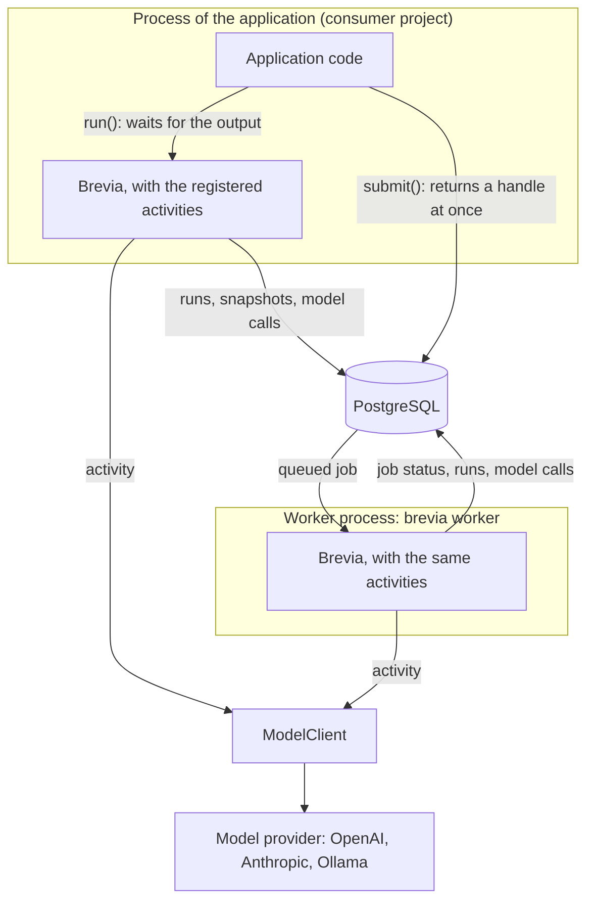

# Concepts

This page explains how a project uses Brevia and the terms used in the rest of the
documentation. Read it after [Getting started](getting-started.md); each section links
to the guide with the details.

## How the parts fit

The consumer project holds the domain logic: it writes its activities, registers them
on a `Brevia` object and calls them. Brevia composes the configuration, calls the
activity, gives it the declared prompts and a client of the configured model, enforces
the limits and records the run in PostgreSQL. An activity runs in one of two ways:

- **Direct run**, `brevia.run()`: the activity runs in the process of the caller, which
  waits for the output. It does not survive a restart of the process; a caller that
  wants it again runs it again.
- **Job**, `brevia.submit()`: the request is recorded and queued in the database, and
  the caller gets a handle at once. A separate `brevia worker` process, which loads the
  same application, runs it. A job survives restarts, and an idempotency key prevents
  running it twice when the caller retries. See [Jobs](guides/jobs.md).

## Terms

Activity
:   An application feature with typed input, output and configuration, registered
    under a dotted name such as `document.summarize`. It is what callers run. It may be
    deterministic code, call a model along a fixed path or let a model decide
    some steps.

Run
:   One execution of an activity, with an identifier. It is recorded in the database
    with its input, snapshot, outcome and model calls (see
    [Recorded runs](guides/runs.md)).

Job
:   A run executed by a worker and kept in the database: it has a status, can be
    cancelled and retried, and starts again from the beginning after an interruption.

Project file
:   `brevia.toml`, versioned with the project: the models it may use with their
    capabilities and prices, the run limits and the defaults of each activity.

Configuration
:   The settings of one run, validated against the configuration schema of the
    activity. They are composed from the project defaults, the customisations stored
    in the database and the overrides of the request, each limited to the fields the
    activity declares customisable or overridable (see
    [Configuration](guides/configuration.md)).

Snapshot
:   The values a run uses, recorded at its start: the resolved configuration, the
    prompts with their fingerprints, the declared models, the limits, the model adapter
    and the Brevia and application versions. It contains no secrets. A run uses these
    values even if the project changes while it works; a job fixes them when it first
    starts and keeps them when it starts again (see
    [Jobs](guides/jobs.md#values-fixed-when-the-job-starts)).

Model reference
:   A name such as `openai:gpt-6-luna` or `ollama:llama3.3`. Brevia rejects options that
    the declared capabilities of a model do not allow, and reports an unknown cost as
    unknown, never as zero (see [Models and limits](guides/models.md)).

Tool and agent
:   Planned. A tool is a function exposed to a model, with a description, typed
    parameters and permissions; an agent uses a model to choose steps or tools within
    a goal, permissions and limits set by the code. A job need not be agentic, and an
    agent need not run as a job.

!!! note "Available today"
    Activities run directly or as jobs, with deterministic code and model calls along
    a fixed path, or with model-selected tools through `generate(tools=...)`.
    See [Tools](guides/tools.md); there is no separate agent runtime.

## Choosing

- Use a **direct run** when the caller waits for the result and can simply retry a
  failure.
- Use a **job** when the work is long, must survive restarts, or must not be repeated
  by a caller that retries.
- Use a **fixed path** when the steps are known in advance: it is simpler to test and
  to reason about.
- Use a **model with tools** only when the steps genuinely depend on intermediate
  results, with the smallest set of tools that does the job.
