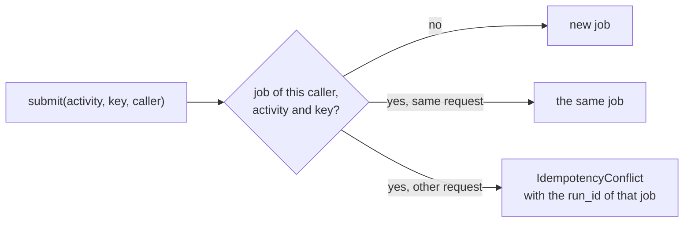
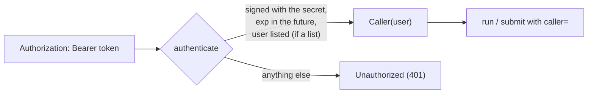
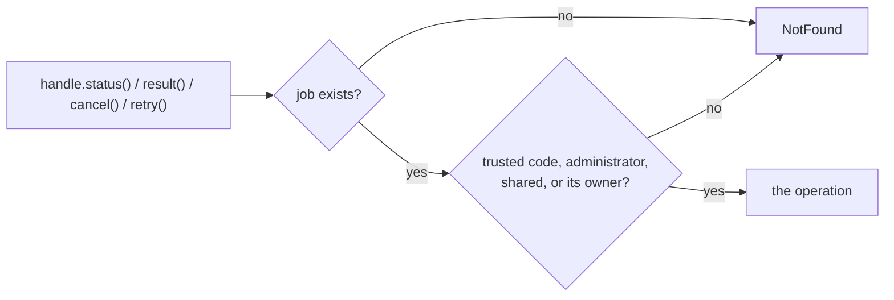

# Callers and access

Brevia records who asks for each run and each job: the *caller*, identified by a token. A caller is the
application that calls Brevia, for example the backend of a project, not a person. The
same backend may serve many users: it can say which one with `end_user`.

## Choosing a set-up

Most installations need one of three set-ups. Start from the simplest that fits:
moving to another one changes the settings, while the code that passes the caller
stays the same.

| Set-up | When | Settings |
|---|---|---|
| **Local development** | One developer, on their own machine | `BREVIA_AUTH_DISABLED=true` |
| **One internal application** | A single backend calls Brevia for all its users, for example an internal tool whose users sign in to the backend (with Azure Active Directory or another identity provider) | `BREVIA_TOKENS_SECRET`, one token for the backend, `BREVIA_ACCESS_POLICY=shared` |
| **Several applications** | Different backends or frontends share one installation, and each must see only its own jobs | `BREVIA_TOKENS_SECRET`, one token per application, `BREVIA_ACCESS_POLICY=per-caller` (the default), `BREVIA_ACCESS_ADMINS` for the one that manages configurations and prompts |

!!! note "The settings choose the rules; the caller comes from the code"
    `Brevia.from_settings()` reads the access policy, but it does not check tokens by
    itself. The [HTTP API](http-api.md) does it for every request; code that receives
    requests in another way does it itself:

    1. creates the authenticator once, at start-up: `Authenticator.from_settings()`;
    2. for each request, gets the caller from its token: `authenticator.authenticate(token)`;
    3. passes it to every operation: `caller=` on `run`, `submit`, `job`, `jobs`,
       `find_job`, `add_feedback` and the changing operations of configurations and
       prompts.

    An operation without `caller=` is trusted code and may do everything, whatever the
    policy. An application that imports Brevia in its own process, without serving
    other applications, needs no token at all.

### One internal application

The users sign in to the application, not to Brevia: Brevia sees a single caller, the
backend, identified by its token. Nothing about the users is configured in Brevia.

```sh
# .env of the Brevia installation
BREVIA_TOKENS_SECRET=...            # at least 32 bytes, kept secret
BREVIA_ACCESS_POLICY=shared         # the backend sees and manages everything
```

```console
$ brevia token create --user internal-backend --minutes 525600   # one year
```

The backend sends the token with every call and may pass the user who asked for a job
as `end_user`, which is recorded for tracing and grants nothing:

```python
caller = Caller("internal-backend", end_user=user_id)
```

With `per-caller` instead of `shared` the backend would see the same jobs (they are all
its own); it would only need to be listed in `BREVIA_ACCESS_ADMINS` to change
configurations and prompts. `shared` avoids that step.

!!! warning "Keep the token out of the browser"
    The token gives everything that its caller may do. If a frontend calls Brevia from
    the browser, any user can read the token with the developer tools of the browser
    and, with `shared`, read every job and change the prompts. Let the backend call
    Brevia, so that the token stays on the server, or give the frontend its own token
    under `per-caller`. A token of its own separates the frontend from the other
    applications, not its users from each other: every user of the frontend can read,
    cancel and retry every job of that caller. `end_user` adds no isolation; to
    keep users apart, let a backend check them before it calls Brevia.

!!! warning "Disabled authentication is for local development only"
    With `BREVIA_AUTH_DISABLED=true` anyone who reaches Brevia can submit jobs, which
    spend the credit of the model providers, and read the results of the other
    anonymous requests, also on an internal network. Every request is the caller
    `anonymous`, never trusted code, so it cannot read local files of the server. A
    token costs one command; keep it on every shared installation.

## The caller of an operation

[`Caller`](../reference/access.md#brevia.Caller) has two fields:

| Field | What it is | Example |
|---|---|---|
| `name` | The calling application. With the HTTP API it is the `user` field of the JWT, as in Brevia 0.15 | `"bedita-backend"` |
| `end_user` | Optional, opaque identifier of the end user, given by a trusted caller: an id or a hash, never a name or an email address. It is recorded for tracing and grants no permission. With the HTTP API it is the `end_user` field of the body of `POST /runs`, of `POST /runs/{run_id}/feedback` and of the changes of configuration and prompts | `"user-42"` |

Both are non-blank strings of at most 200 characters, without NUL characters (which
PostgreSQL refuses in text); any other value raises `ValueError`.

`run` and `submit` accept it as `caller=`:

```python
from brevia import Caller

caller = Caller("bedita-backend", end_user="user-42")

result = await brevia.run("document.summarize", request, caller=caller)
handle = await brevia.submit(
    "document.summarize", request, idempotency_key="summary-2026-10", caller=caller
)
```

Without `caller`, the operation is asked by trusted code in the process: a script, a
test, a worker, the command line. It records no caller (`NULL`).

## What is recorded

`runs.caller` and `runs.end_user` hold the two fields, for direct runs (when they
are [recorded](runs.md#what-is-recorded)) and for jobs. A [retry](jobs.md#retry) belongs
to the caller of the job it retries, whoever asks for it. `feedback.caller` and
`feedback.end_user` hold them for the [feedback](runs.md#feedback) added to a run.

## Idempotency keys belong to their caller

An [idempotency key](jobs.md#idempotency) is scoped to the caller and the activity:



Two callers that use the same key get two jobs: a key chosen by one caller never finds,
or reveals, the job of another. `IdempotencyConflict` therefore names only a job of the
same caller. Trusted code without a caller has keys of its own too.

## Authentication

A caller proves its name with a token, as in Brevia 0.15: a JWT signed with HS256,
with two claims, `user` (the name of the caller) and `exp` (its expiry). Tokens issued
by Brevia 0.15 stay valid when the installation keeps the same secret.

### Settings

| Variable | Default | Meaning |
|---|---|---|
| `BREVIA_TOKENS_SECRET` | none | Secret that signs and verifies tokens. Required, unless authentication is disabled. Set it to the `TOKENS_SECRET` of Brevia 0.15 to keep its tokens valid |
| `BREVIA_TOKENS_USERS` | empty | Comma-separated names of the callers whose tokens are accepted; empty accepts any name, as `TOKENS_USERS` in Brevia 0.15 |
| `BREVIA_AUTH_DISABLED` | `false` | Accept requests without a token, for local development only |
| `BREVIA_STATUS_TOKEN` | none | Token of `GET /status` of the [HTTP API](http-api.md#health), accepted besides the token of a caller, as `STATUS_TOKEN` in Brevia 0.15 |

Without a secret, and without `BREVIA_AUTH_DISABLED=true`, the authenticator cannot be
created (`ValueError`): an installation that forgot the secret does not start open.
This is a deliberate difference from Brevia 0.15, which turned the protection off.
A secret shorter than 32 bytes is accepted, so that existing tokens stay valid, with
one warning in the log when the authenticator is created.

### Creating a token

```console
$ export BREVIA_TOKENS_SECRET=...   # or in .env
$ brevia token create --user bedita-backend --minutes 1440
eyJhbGciOiJIUzI1NiIsInR5cCI6IkpXVCJ9...
```

The command reads only the secret, not the database settings. The default validity is
60 minutes, as `create_token` of Brevia 0.15. In Python:
[`create_token(user, minutes, secret)`](../reference/access.md#brevia.create_token).

### Verifying a token

```python
from brevia import Authenticator, Unauthorized

authenticator = Authenticator.from_settings()  # BREVIA_TOKENS_* and .env

try:
    caller = authenticator.authenticate(token)  # Caller("bedita-backend")
except Unauthorized:
    ...  # HTTP 401
handle = await brevia.submit("document.summarize", request, caller=caller)
```



`Unauthorized` does not say why a token was refused (missing, expired, wrong
signature, another algorithm, `user` missing, blank or not listed): the reason would
help to forge one. With authentication disabled, `authenticate` returns the caller
`anonymous` for every request, whatever its token: a caller like the others, not
trusted code. The access policy applies to it, and local paths of files are refused.
Under `per-caller` it sees the jobs of every anonymous request, and changes
configurations and prompts only if `anonymous` is listed in `BREVIA_ACCESS_ADMINS`, or
with `shared`.

| | Brevia 0.15 | Brevia 1.0 |
|---|---|---|
| Library | python-jose | PyJWT, same algorithm and claims |
| Without a secret | protection off | refused, unless `BREVIA_AUTH_DISABLED=true` |
| Token without `exp` | accepted | refused (`create_token` of 0.15 always sets it) |
| The `user` of the token | checked, then discarded | becomes the caller, recorded with runs and jobs |
| Command | `create_token -u NAME -d MINUTES` | `brevia token create --user NAME --minutes MINUTES` |

The [HTTP API](http-api.md) reads the token from `Authorization: Bearer` and creates
the authenticator when the app is created.

## Access to runs and customisations

The access policy decides what a caller may do. It is chosen by the installation, never
by a request:

| Variable | Default | Meaning |
|---|---|---|
| `BREVIA_ACCESS_POLICY` | `per-caller` | `per-caller`: each caller sees only the jobs it created. `shared`: every caller sees and does everything, as any valid token in Brevia 0.15 |
| `BREVIA_ACCESS_ADMINS` | empty | Comma-separated names of the callers that see every job and may change configurations and prompts |

| Who asks | Its own jobs | Jobs of other callers, or of trusted code | Change configuration and prompts | Read configuration and prompts |
|---|---|---|---|---|
| A caller, `per-caller` | yes | not found (`NotFound`) | no (`Forbidden`) | yes |
| An administrator, or any caller with `shared` | yes | yes | yes | yes |
| Trusted code (`caller=None`) | yes | yes | yes | yes |

With a single backend and a single token, `per-caller` behaves as `shared` for that
backend's jobs. Customisations apply to the whole installation, so with `per-caller`
only administrators may change them: list the backend that manages them in
`BREVIA_ACCESS_ADMINS`, or use `shared` (see [Choosing a set-up](#choosing-a-set-up)).

A job is read through a handle that remembers its caller: the handle returned by
`submit`, or `brevia.job(run_id, caller=caller)`. Each of its methods (`status`,
`result`, `cancel`, `retry`, `file`) reads the job again and checks it:

```python
handle = brevia.job(run_id, caller=caller)
try:
    state = await handle.status()
except NotFound:
    ...  # no such job, or a job of another caller: HTTP 404 in both cases
```



A job of another caller raises the same `NotFound`, with the same details, as a job
that does not exist, so that its identifier reveals nothing. A retry asked by an
administrator still belongs to the caller of the job it retries.

The changing operations of configurations and prompts (`customize_configuration`,
`reset_configuration`, `customize_prompt`, `reset_prompt`) accept `caller=` and raise
`Forbidden` (HTTP 403) when the policy does not allow it; nothing is stored.

```python
await brevia.customize_configuration(
    "document.summarize", {"language": "fr"}, author="editor", caller=caller
)
```

`brevia.access.access` holds the [`AccessPolicy`](../reference/access.md#brevia.AccessPolicy)
in use; a `Brevia` created without `from_settings` takes it as `access=`.

| | Brevia 0.15 | Brevia 1.0 |
|---|---|---|
| Who reads a job | any valid token | its caller, administrators, or every caller with `shared` |
| A job of another caller | readable | `NotFound`, as a job that does not exist |
| Who changes configurations and prompts | any valid token | administrators, or every caller with `shared` |

## Limits

- The policy has two forms, `per-caller` and `shared`, with a list of administrators:
  no rules per activity or per operation, and no policy registered by a project. They
  are added when a project needs them.
- The traces of a run (its model calls and their contents) cannot be read, from Python
  or over HTTP: they are only recorded.
