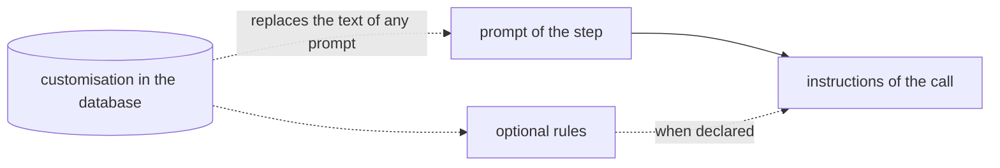
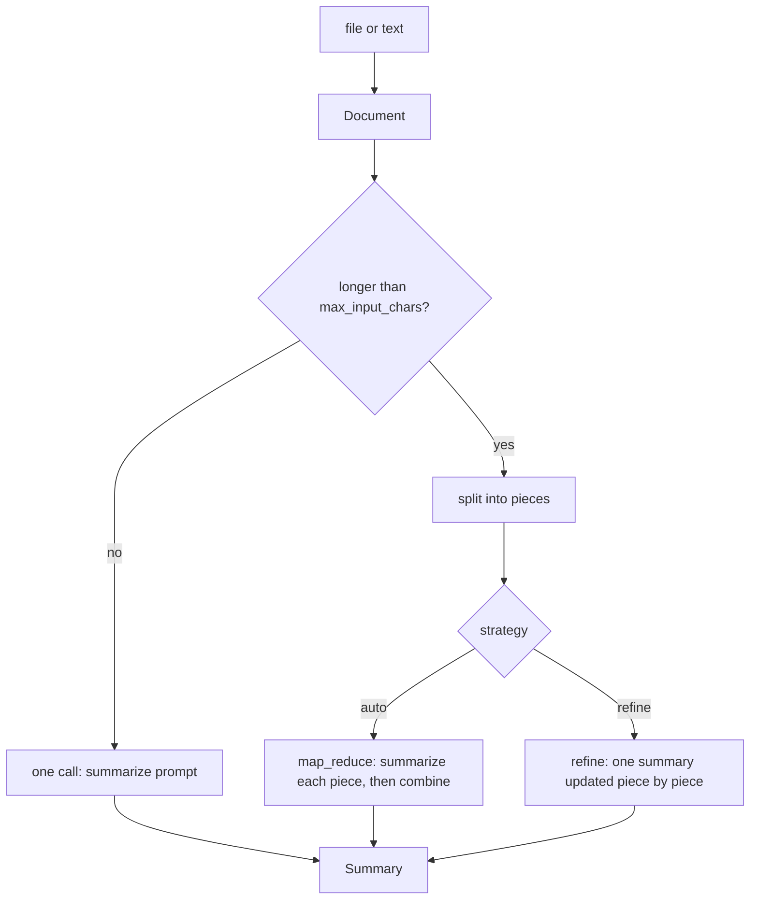
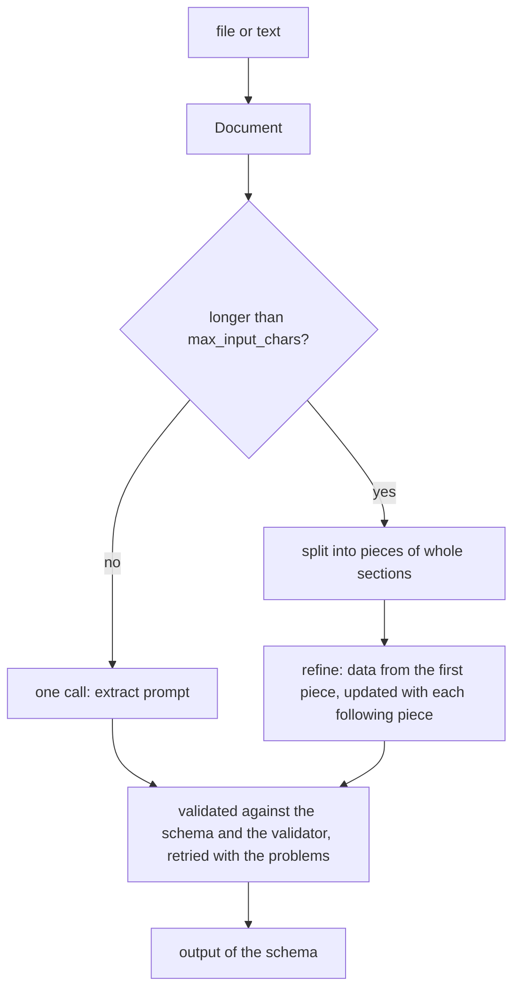

# Analysis activities

Brevia gives ready activities for the analysis of documents, `summarize` and
`extract`, built with the
[strategies and building blocks](pipelines.md). A project registers them like its own
activities, chooses their name, modes and defaults, and can replace their prompts.

## Prompts at a glance

Every prompt is a prompt of the activity: it can be replaced by a file of the project
in `register_activity(prompts=...)`, each one on its own, or customised in the
database with its history. The prompts of the package are in English; the paths of a
project are relative to the folder of `brevia.toml`.

| Function | Prompts of the package | Used for | Optional rules |
|---|---|---|---|
| `summarize`, `summarize_document` | `summarize` | the whole document, or each piece | `summarize_rules` |
| | `summarize_combine` | the combination of the summaries of the pieces (`auto`) | |
| | `summarize_refine` | the update with the next piece (`refine`) | |
| `extract`, `extract_document` | `extract` | the whole document, or the first piece | `extract_rules` |
| | `extract_refine` | each following piece | |
| `map_reduce`, `refine` (strategies) | none: the caller gives them | each step | `rules=` |

Replacing one prompt changes only its step. Optional rules, when declared, follow the
prompt of every call of their function: a rule of the project written once reaches
every step of a long document. They are off by default.



## `summarize`

A summary of a file (PDF, DOCX, text) or of a text.



Register it in the application:

```python
from brevia.analysis import (
    SUMMARIZE_PROMPTS,
    SummarizeConfig,
    SummarizeRequest,
    Summary,
    summarize,
)

brevia.register_activity(
    name="summarize",
    version="1",
    function=summarize,
    input_type=SummarizeRequest,
    output_type=Summary,
    config_type=SummarizeConfig,
    prompts=SUMMARIZE_PROMPTS,
    overridable=["strategy"],
    modes={"direct", "job"},
)
```

and give its model in the project file:

```toml
[models."openai:gpt-6-luna"]
reasoning_levels = ["low", "medium", "high"]

[activities.summarize]
model = "openai:gpt-6-luna"
language = "Italian"
max_input_chars = 120000
```

Run it from Python:

```python
result = await brevia.run("summarize", SummarizeRequest(text=minutes))
print(result.summary)

handle = await brevia.submit(
    "summarize",
    SummarizeRequest(
        file=FileSource(name="report.pdf", url="https://docs.example.org/r.pdf")
    ),
)
```

or over HTTP, with `POST /runs`:

```json
{
  "activity": "summarize",
  "input": {"file": {"name": "report.pdf", "url": "https://docs.example.org/r.pdf"}},
  "mode": "job"
}
```

The output is `{"summary": "..."}`.

### Request

| Field | Meaning |
|---|---|
| `file` | Input file, a `FileSource` (see [Files](files.md)) |
| `text` | Text to summarise; exactly one of `file` and `text` |
| `language` | Language of the summary, as a name (`"English"`), at most 40 characters; the configured one when not given |

### Configuration

| Field | Default | Meaning |
|---|---|---|
| `model` | required | Model of every call: a reference (`"openai:gpt-6-luna"`) or a model use with its options; an override may change one option, such as `model.reasoning` |
| `language` | not set | Language of the summary when the request gives none, as a name: it is written in the prompts. Not set, the summary keeps the language of the document |
| `strategy` | `"auto"` | For a longer document: `"auto"` summarises the pieces and combines them; `"refine"` updates one summary piece by piece, following the order of the document |
| `max_input_chars` | `120000` | Longest text of one call, in characters; a longer document is divided into pieces (whole sections while they fit, see [Pieces](documents.md#pieces)) |
| `max_output_tokens` | the `max_tokens` of the model | Most tokens that each call may generate; for reasoning models it includes the reasoning, so a low value can end a call before any answer. The length of the summary is set by the prompt, not by this limit |

A document of 1,000,000 characters with the default size needs about 10 calls: one for
each of about 9 pieces and one combination. The calls, and their retries, count against
the limits of the run (`max_requests`, 20 by default): raise them for the activity when
its documents are very long, with `register_activity(..., limits=RunLimits(max_requests=50))`.

Keep `max_input_chars` well above the length of a summary: the summaries of two pieces
must fit in one combination, otherwise the run stops with `limit_exceeded`. With
`refine` the summary is condensed at each step, not appended to.

### Prompts

`SUMMARIZE_PROMPTS` points to three prompts of the package, in English, each with a
`{language}` variable:

| Prompt | Used for |
|---|---|
| `summarize` | The whole document, or each piece |
| `summarize_combine` | The combination of the summaries of the pieces (`auto`) |
| `summarize_refine` | The update of the summary with the next piece (`refine`); it also has `{previous}`, the summary so far |

Every prompt can be replaced by a file of the project, each one on its own:

```python
prompts = {**SUMMARIZE_PROMPTS, "summarize": "prompts/assembly-summary.md"}
```

A replaced prompt changes only its step. With the line above, a long document is still
combined with `summarize_combine` and updated with `summarize_refine` of the package:
a rule written only in `summarize` (for example "only the decisions of the assembly") does
not reach those steps. Replace them too, or give the rule once as rules of the project.

#### Rules of the project (optional)

`summarize_rules` is a prompt that the package does not have. When the activity
declares it, its text, without variables, is added after the prompt of every call:
the whole document, each piece, the combination and each update.

```python
prompts = {**SUMMARIZE_PROMPTS, "summarize_rules": "prompts/assembly-rules.md"}
```

```markdown
Report only the decisions of the assembly, with their amounts and deadlines.
Leave out the discussion that led to them.
```

| Call | Instructions without `summarize_rules` | With `summarize_rules` |
|---|---|---|
| Whole document, or a piece | `summarize` | `summarize`, then the rules |
| Combination (`auto`) | `summarize_combine` | `summarize_combine`, then the rules |
| Update (`refine`) | `summarize_refine` | `summarize_refine`, then the rules |

Without `summarize_rules` nothing changes. The rules are an option of Brevia, not a
pattern taken from other frameworks: check the results on documents of the project
before relying on them.

The prompts, the rules included, can also be customised in the database, with their
history (see [Prompts](prompts.md)); a customised prompt must keep the same variables,
and only a declared prompt can be customised: to change the rules from the database,
declare a file first.

### Errors

| Error | When |
|---|---|
| `invalid_input` | Neither or both of `file` and `text`; an empty text; a file that cannot be read |
| `unsupported` | The file is not a readable format |
| `not_found`, `unavailable`, `file_too_large` | The file cannot be obtained (see [Files](files.md)) |
| `limit_exceeded` | The calls go over the limits of the run, or two summaries do not fit one combination |
| As for every run | `output_invalid`, `run_timeout`, `provider_error` |

### Inside another activity

`summarize_document(ctx, document, language=...)` gives the same summary inside a
pipeline of the project. The activity that calls it declares the prompts it needs:

```python
async def minutes_pack(request: PackRequest, ctx: RunContext[PackConfig]) -> Pack:
    minutes = await ctx.files.read(request.minutes)
    summary = await summarize_document(ctx, minutes, language="Italian")
    ...


brevia.register_activity(..., prompts={**SUMMARIZE_PROMPTS, "pack": "prompts/pack.md"})
```


## `extract`

Data of a file or a text, validated against a schema of the project. The schema
belongs to the project, so the project writes a short activity that calls `extract`
with its output type and, if it needs one, its own validator:

```python
from decimal import Decimal

from pydantic import BaseModel

from brevia import OutputInvalid, RunContext
from brevia.analysis import EXTRACT_PROMPTS, ExtractConfig, ExtractRequest, extract


class InvoiceData(BaseModel):
    """What the model fills in, piece by piece: a field may still be missing."""

    number: str | None = None
    date: str | None = None
    total: Decimal | None = None


class Invoice(BaseModel):
    """The output of the activity: every field present."""

    number: str
    date: str
    total: Decimal


def check_total(data: InvoiceData) -> list[str]:
    if data.total is not None and data.total < 0:
        return ["the total cannot be negative"]
    return []


async def extract_invoice(
    request: ExtractRequest, ctx: RunContext[ExtractConfig]
) -> Invoice:
    data = await extract(ctx, request, InvoiceData, validator=check_total)
    missing = sorted(name for name, value in data if value is None)
    if missing:
        raise OutputInvalid("The invoice is incomplete", {"missing": missing})
    return Invoice.model_validate(data.model_dump())


brevia.register_activity(
    name="invoice.extract",
    version="1",
    function=extract_invoice,
    input_type=ExtractRequest,
    output_type=Invoice,
    config_type=ExtractConfig,
    prompts=EXTRACT_PROMPTS,
    modes={"direct", "job"},
)
```



`ExtractRequest` has `file` or `text`, exactly one. A long document is read piece by
piece with [`refine`](pipelines.md#refine): the data found so far is given back to the
model with each new piece, and the prompt asks to keep every item already found and add
the new ones. Whether the model keeps them all depends on the model: for long lists,
check the result in the project (for example the number of items) or use a pipeline
that extracts each piece separately and joins the lists in code.

Every step, the first piece included, is validated against the schema and the
validator, so both must accept partial data: a field found only in a later piece (the
total at the end of the document) is optional in the schema given to `extract`, as in
`InvoiceData` above, otherwise the first call fails or the model invents a value.
Completeness and rules on the whole result (a total equal to the sum of the items) are
checked after `extract` returns, as `extract_invoice` does.

### Configuration

| Field | Default | Meaning |
|---|---|---|
| `model` | required | Model of every call: a reference (`"openai:gpt-6-luna"`) or a model use with its options; an override may change one option, such as `model.reasoning` |
| `max_input_chars` | `120000` | Longest text of one call, in characters |
| `max_output_tokens` | the `max_tokens` of the model | Most tokens that each call may generate, reasoning included |
| `max_attempts` | `3` | Attempts of each call to obtain data valid for the schema and the validator |

A project that needs more settings extends `ExtractConfig`, and registers it as the
configuration of the activity:

```python
class InvoiceConfig(ExtractConfig):
    currency: str = "EUR"


async def extract_invoice(
    request: ExtractRequest, ctx: RunContext[InvoiceConfig]
) -> Invoice:
    ctx.log.info("Invoices in %s", ctx.config.currency)
    return await extract(ctx, request, Invoice)
```

### Prompts

| Prompt | Used for |
|---|---|
| `extract` | The whole document, or the first piece |
| `extract_refine` | Each piece after the first; `{previous}` is the data found so far, as JSON |
| `extract_rules` (optional, not in the package) | Added after the prompt of every call, when the activity declares it |

The prompts of the package are generic: they ask to use only the document and to copy
values exactly. The meaning of the fields comes from the schema, so describe the fields
there (`Field(description=...)`). Each prompt can be replaced by a file of the project,
on its own; a replaced `extract` is used only for the whole document or the first
piece.

For a rule that must reach every piece of a long document, for example "extract only
the invoices marked as paid", declare `extract_rules`:

```python
prompts = {**EXTRACT_PROMPTS, "extract_rules": "prompts/paid-invoices.md"}
```

| Call | Instructions without `extract_rules` | With `extract_rules` |
|---|---|---|
| Whole document, or the first piece | `extract` | `extract`, then the rules |
| Each following piece | `extract_refine` | `extract_refine`, then the rules |

Without `extract_rules` nothing changes. As for `summarize_rules`, the rules are an
option of Brevia: check the results on documents of the project before relying on
them.

### Errors

| Error | When |
|---|---|
| `invalid_input` | Neither or both of `file` and `text`; an empty text; a file that cannot be read |
| `unsupported` | The file is not a readable format |
| `not_found`, `unavailable`, `file_too_large` | The file cannot be obtained (see [Files](files.md)) |
| `output_invalid` | No data valid for the schema and the validator within `max_attempts` |
| `limit_exceeded` | The calls go over the limits of the run |

`extract_document(ctx, document, Invoice)` gives the same extraction inside a pipeline of
the project, as `summarize_document` does for summaries. The names of the prompts of
the two functions are distinct, so one activity can use both:
`prompts={**SUMMARIZE_PROMPTS, **EXTRACT_PROMPTS}`; `summarize_rules` and
`extract_rules` apply each to its own function.

The reference is in [Analysis](../reference/analysis.md).


## Runnable examples

See [the executable analysis example](analysis-example.md) for a complete application with a fake model. Model-selected file operations are described in [Tools](tools.md).
