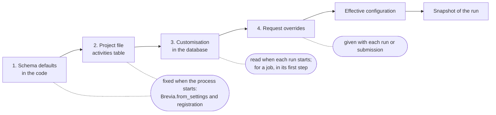

# Configuration

Read this page when you need to choose where a value lives: in the environment of an
installation, in the project file, in a customisation stored in the database, or in a
single request. It ends with what happens when a value is refused.

## Installation settings

Installation settings differ between installations of the same project. They are read
from environment variables with the `BREVIA_` prefix, or from a `.env` file:

| Variable | Default | Meaning |
|---|---|---|
| `BREVIA_PROJECT_FILE` | `brevia.toml` | Path of the project file |
| `BREVIA_LOG_LEVEL` | `INFO` | Log level used by `configure_logging` callers |
| `BREVIA_LOG_FORMAT` | `text` | `text` or `json` |
| `BREVIA_RECORD_DIRECT_RUNS` | `true` | Record direct runs and their model calls ([Recorded runs](runs.md)) |
| `BREVIA_FAKE_MODELS` | `false` | Answer every model call with a fake, without a provider: local runs and tests only ([Testing](testing.md)) |
| `BREVIA_DATABASE_URL` | required | PostgreSQL connection URL, a secret |
| `BREVIA_DATABASE_*` | | Schema, pool and timeouts: see [Database](database.md) |
| `BREVIA_JOBS_SCHEMA`, `BREVIA_APP_VERSION`, `BREVIA_WORKER_*` | | Jobs and the worker: see [Workers](workers.md#settings) |
| `BREVIA_TOKENS_SECRET`, `BREVIA_TOKENS_USERS`, `BREVIA_AUTH_DISABLED`, `BREVIA_STATUS_TOKEN` | | Tokens of the callers and of `GET /status`: see [Callers](access.md#settings) |
| `BREVIA_FILES_ROOT`, `BREVIA_FILES_*` | `BREVIA_FILES_ROOT` none, the others in [Files](files.md#settings) | Files of runs: see [Files](files.md#settings) |
| `BREVIA_ACCESS_POLICY`, `BREVIA_ACCESS_ADMINS` | `per-caller`, empty | What each caller may do: see [Access](access.md#access-to-runs-and-customisations) |

Provider credentials are not Brevia settings: providers read them from their standard
environment variables, such as `OPENAI_API_KEY`, `ANTHROPIC_API_KEY` and
`OLLAMA_BASE_URL`. They never appear in project files, snapshots or logs. Brevia reads
its own `BREVIA_*` values from `.env`, but does not export the other variables of that
file: provider credentials must be in the environment of the process, for example
exported by the shell, the container or a tool that loads `.env` files.

## Project settings

Project settings are versioned with the project, in the project file: the declared
[models](models.md#declared-capabilities), the [run limits](models.md#run-limits) and
the defaults of each activity, in its `[activities."<name>"]` table.

## Defaults of Brevia

Every functional default of the library is in one module, `brevia.config.defaults`; the
classes and functions of Brevia refer to it instead of repeating values. A project
replaces a default by writing the value in its project file. The project file of the
[template](project-template.md) writes the main ones out, so a new project shows the
values it uses; a value left out of the file takes the default of the module.

| Default | Value | Replaced in the project file by |
|---|---|---|
| `MODEL_MAX_TOKENS` | not set: the maximum of the model | `max_tokens` of the model use of an activity (see [Models](models.md#output-tokens-and-reasoning)) |
| `GENERATION_MAX_ATTEMPTS` | 3 | `max_attempts` of the activities that declare it, such as `extract` |
| `RUN_MAX_REQUESTS` | 20 | `[limits] max_requests` |
| `RUN_MAX_TOOL_CALLS` | 0: no limit | `[limits] max_tool_calls` |
| `RUN_MAX_TOTAL_TOKENS` | 0: no limit | `[limits] max_total_tokens` |
| `RUN_MAX_SECONDS` | 900 | `[limits] max_seconds` |
| `RUN_PROVIDER_RETRIES` | 2 | `[limits] provider_retries` |
| `SUMMARIZE_LANGUAGE` | not set: the language of the document | `language` of a `summarize` activity |
| `SUMMARIZE_STRATEGY` | `auto` | `strategy` of a `summarize` activity |
| `SUMMARIZE_MAX_INPUT_CHARS` | 120,000 | `max_input_chars` of a `summarize` activity |
| `EXTRACT_MAX_INPUT_CHARS` | 120,000 | `max_input_chars` of an `extract` activity |
| `TRACE_RETENTION_DAYS` | 0: kept without a time limit | `[traces] retention_days` |

`0` turns a run limit or the retention off; this is how a project turns off a limit
that is on by default. A default that is not set applies when the value is left out:
TOML has no empty value.

The model use of an activity is a table when it sets more than the model:

```toml
[activities."document.summarize"]
language = "Italian"

[activities."document.summarize".model]
model = "openai:gpt-6-luna"
max_tokens = 16000
```

A project that keeps a value of the template keeps it when a later version of Brevia
changes the default: the project file is the project's choice. The defaults of the
configuration class of an activity written by the project, like the one of the
template, belong to the project, not to this module.

Installation settings (database, files, logs) are not defaults of this kind: they are
the `BREVIA_*` environment variables above.

## The four levels

The configuration of a run is composed from four levels, each overriding the previous
one. Each level is read at a different moment, and the result is recorded in the
[snapshot](runs.md#snapshots) of the run:



| Level | Where it is set | Paths it may set | When it is read |
|---|---|---|---|
| 1. Schema defaults | The defaults of the configuration class | Every field | When the activity is registered |
| 2. Project file | `[activities."<name>"]` | Every field | When `Brevia.from_settings()` loads the file; checked at registration |
| 3. Customisation | The database, through `customize_configuration` | The paths declared in `customizable` | At the start of each direct run; for a [job](jobs.md#values-fixed-when-the-job-starts), in its first step in the worker |
| 4. Overrides | The `overrides` of `run` or `submit` | The paths declared in `overridable` | With each request |

Changing the code or the project file requires restarting the processes; a
customisation applies to the next run in every process, without a release. A run that
has started keeps the values of its snapshot.

### A worked example

The configuration class gives `it` as default language:

```python
from pydantic import BaseModel, Field


class SummaryConfig(BaseModel):
    model: str
    max_output_tokens: int = Field(default=1200, gt=0)
    language: str = "it"
```

This is the configuration of [Getting started](../getting-started.md), whose
activity also reads `max_output_tokens`.

The project file sets `en`:

```toml
[activities."document.summarize"]
model = "openai:gpt-6-luna"
language = "en"
```

The activity lets both a customisation and a request change the language:

```python
brevia.register_activity(
    name="document.summarize",
    version="1",
    function=summarize,
    input_type=SummaryRequest,
    output_type=SummaryResult,
    config_type=SummaryConfig,
    prompts={"summary": "prompts/summary.md"},
    overridable=["language"],
    customizable=["language"],
)
```

An editor customises it to `fr`, and a request overrides it with `de`:

```python
async with brevia:
    state = await brevia.customize_configuration(
        "document.summarize", {"language": "fr"}, author="editor"
    )
    request = SummaryRequest(text="The document to summarise...")
    await brevia.run("document.summarize", request)  # language "fr"
    await brevia.run(
        "document.summarize", request, overrides={"language": "de"}
    )  # language "de"

    # Later, still with Brevia started (see Resetting a customisation below):
    state = await brevia.reset_configuration(
        "document.summarize", ["language"], expected_version=state.version
    )
```

| Level | Value of `language` |
|---|---|
| 1. Schema default | `it` |
| 2. Project file | `en` |
| 3. Customisation | `fr` |
| 4. Request override | `de` |
| **Effective, with the override** | **`de`** |
| Effective, without an override | `fr` |

The state returned by `customize_configuration` shows the levels apart:
`state.defaults["language"]` is `en` (levels 1 and 2), `state.customization` is
`{"language": "fr"}` and `state.effective["language"]` is `fr`, the value of a run
without overrides.

### Resetting a customisation

`reset_configuration` removes fields from the customisation, so that the project value
becomes active again for the next runs. Like every operation on customisations, it
needs a started Brevia; in the example above it runs inside `async with brevia`:

```python
state = await brevia.reset_configuration(
    "document.summarize", ["language"], expected_version=state.version
)
assert state.customization == {}
assert state.effective["language"] == "en"
```

| Run | Value of `language` |
|---|---|
| Started before the reset | `fr` (or `de` with the override), kept in its snapshot |
| New run without an override | `en`, from the project file |
| New run with `{"language": "de"}` | `de` |

The schema default `it` becomes active only if the project file stops setting the
field. `reset_configuration(name)` without fields removes the whole customisation; a
list of fields removes those alone and keeps the others.

### Settings shared by several activities

Each activity has its own `[activities."<name>"]` table. When several activities need
the same settings, for example the description of an input file they all read, put
them once in the schema as a default instead of repeating them in each table:

```python
import tomllib
from functools import cache
from pathlib import Path
from typing import Any

from pydantic import BaseModel, Field


class SheetLayout(BaseModel):
    sheet: str
    columns: dict[str, str]


@cache
def _layout_file() -> dict[str, Any]:
    return tomllib.loads(Path(__file__).with_name("layout.toml").read_text())


def default_layout() -> SheetLayout:
    # A new object for each configuration: a change made by one never reaches the others.
    return SheetLayout.model_validate(_layout_file())


class ReportConfig(BaseModel):
    model: str
    layout: SheetLayout = Field(default_factory=default_layout)


class MemoConfig(BaseModel):
    model: str
    layout: SheetLayout = Field(default_factory=default_layout)
```

The default is level 1: Brevia validates it with the rest of the configuration and
records it in the snapshot of every run, as if it were written in the project file. A
table of the project file can still set `layout` for one activity.

## Composition rules

Composition follows the schema of the configuration, not a generic deep merge:

- an absent field inherits the previous value;
- a present scalar or list replaces the previous value;
- a nested Pydantic model is composed field by field;
- a free mapping (a `dict` field) is replaced as a whole;
- `None` is a value only where the schema allows it.

For example, with this schema:

```python
class Model(BaseModel):
    model: str
    temperature: float | None = None


class Config(BaseModel):
    model: Model
    tags: list[str] = []
```

and the defaults `{"model": {"model": "openai:a"}, "tags": ["x"]}`, the override
`{"model": {"temperature": 0.2}}` produces `model = {"model": "openai:a", "temperature":
0.2}` and keeps `tags = ["x"]`, while the override `{"tags": []}` replaces the list.

Fields are addressed by their name; a field with an alias also accepts the alias in the
project file.

## Allowed overrides

An activity declares the dotted paths a request may override, for example
`overridable=["language", "model.temperature"]`. A declared path allows its children:
`"model"` allows `model.temperature` too.

A nested model that may be `None` (for example `options: Options | None`) is a single
value: an override replaces it as a whole, and its fields cannot be declared
overridable one by one.

## Customisation

A customisation changes the configuration of an activity for every new run, without a
release: for example a longer summary, or another language. An activity declares the
paths that may be customised in `customizable`, separately from those a request may
override in `overridable`.

The operations are methods of a started `Brevia`:

```python
state = await brevia.configuration("document.summarize")
state = await brevia.customize_configuration(
    "document.summarize", {"max_output_tokens": 1800}, author="editor"
)
state = await brevia.reset_configuration("document.summarize", ["max_output_tokens"])
state = await brevia.reset_configuration("document.summarize")  # every field
```

With `caller=`, the changing operations are allowed only to administrators under the
`per-caller` policy (see [Access](access.md#access-to-runs-and-customisations)).

Each returns a [`ConfigurationState`](../reference/customization.md#brevia.ConfigurationState): the
project defaults, the customisation, the effective values of a run without overrides,
the customisable paths, the JSON schema, the version and the author and time of the
last change.

- `customize_configuration` sets the given fields and keeps the others; nested models
  are composed field by field. `None` is a value where the schema allows it, not a
  removal: use `reset_configuration` to remove a field.
- `fields` of `reset_configuration` is a list of dotted paths; a single string is
  refused.
- Secrets are never customisable: credentials stay in the environment.

### Concurrent changes

Each change, a reset included, increments the `version` of the customisation (0 when
it was never changed). Changes are applied one after the other, so two concurrent
changes of different fields are both kept. To avoid overwriting a change made after
you read the state, pass the version you read:

```python
state = await brevia.configuration("document.summarize")
await brevia.customize_configuration(
    "document.summarize", {"language": "fr"}, expected_version=state.version
)
```

If the customisation changed meanwhile, the call raises `VersionConflict`, with the
expected and current versions in its details. Without `expected_version`, the last
change wins.

## When something goes wrong

| Situation | Error | What happens |
|---|---|---|
| A request overrides a path not declared in `overridable` | `OverrideNotAllowed` | The run is refused; the details list the refused paths |
| An override has a value incompatible with the schema, or an unknown field | `InvalidInput` | The run is refused. Unknown fields are refused also when the schema would ignore them (Pydantic's default), so a typo such as `max_output_token` never passes unnoticed; a schema that sets `extra="allow"` accepts any field |
| The project file has the same problems, or names a default model the project does not declare | `Unavailable` | Registration fails, so the application stops at start-up |
| A customisation has unknown or non-customisable fields, invalid or non-finite values, the NUL character (U+0000), or makes the whole configuration invalid | `InvalidInput` | Nothing is stored. The six characters `\u0000` written as text are ordinary text, not a NUL character |
| A reset names a field that is not in the schema, or not customisable and not set | `InvalidInput` | Nothing is changed |
| `expected_version` is no longer current | `VersionConflict` | Nothing is changed: read the state again and decide |
| A customisation stored before a release no longer fits the code, for example after a field is renamed, removed or no longer customisable | `Unavailable` | Runs fail, never falling back silently to the defaults. `configuration` reports the reason in `problem` and `effective` is `None`; `reset_configuration` with that field alone removes it, also when it is no longer in the schema, and keeps the others |

See [Errors](errors.md) for what to do with each error.
