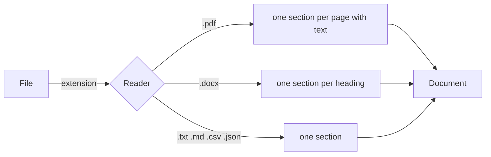

# Documents

`read_document` reads the text of a PDF, DOCX or text file and keeps its structure:
pages of a PDF, headings of a DOCX. Activities use it to give a model the text of a
document, whole or in parts.

```python
from brevia import read_document

document = read_document("assembly-minutes.docx")
for section in document.sections:
    print(section.title, section.page, len(section.text))
print(document.text)  # all sections, with their titles, separated by blank lines
```



## In an activity

An activity receives its documents as `FileSource` values in its input and reads them
with `ctx.files.read`: the file is downloaded or copied as with `ctx.files.local_path`
(see [Files](files.md)), then read in a thread, so that the event loop is not blocked.
The document takes the name of the source, and its extension gives the format: a source
whose extension is not readable is refused with `Unsupported` before it is downloaded.

```python
class ReviewRequest(BaseModel):
    report: FileSource


async def review(request: ReviewRequest, ctx: RunContext[ReviewConfig]) -> Review:
    document = await ctx.files.read(request.report)
    return await ctx.model().generate(
        instructions=ctx.prompt("review").render(),
        user_text=document.text,
        output_type=Review,
    )
```

When the input is a text instead of a file, `Document.from_text(text)` makes a document
of one section, cleaned as the readers do.

## Pieces

A model reads a limited amount of text in one call. `split(document, max_chars)` divides
a document into `Piece` values of at most `max_chars` characters, for pipelines that
work piece by piece:

```python
from brevia import split

for piece in split(document, 50_000):
    first = document.sections[piece.start]
    print(first.page, piece.end - piece.start, len(piece.text))
```

- Whole sections stay together, in order, while they fit: a piece never cuts a page or a
  heading in the middle when it can avoid it.
- A section longer than `max_chars` is divided at its paragraphs (blank lines), and a
  paragraph still longer at `max_chars`; each of its parts is a piece with
  `end - start == 1`.
- `start` and `end` are indices in `document.sections`: with a PDF,
  `document.sections[piece.start].page` is the first page of the piece.
- A title stays with the first paragraph of its section when both fit.
- Pieces do not overlap and lose no text: joined with blank lines they give
  `document.text` again, except where a paragraph longer than `max_chars` was cut.
  Sections without text are skipped.

The size is in characters, not tokens: characters are known before the call and do not
depend on the provider. As a rough guide, a token is three to four characters of
English or Italian text.

## What each reader keeps

| Format | Sections | Details |
|---|---|---|
| PDF (`.pdf`) | One per page with text; `page` is its number, from 1 | Pages without text are skipped. Tables become plain lines: column headers are not linked to their values |
| DOCX (`.docx`) | One per heading (styles `Title` and `Heading 1`, `Heading 2`, ..., or styles based on them); the text before the first heading is a section without title | Paragraphs and tables in reading order, separated by a blank line (the paragraphs at which `split` divides a long section). Each table row is one line with its cells separated by `" \| "`, so that `10` and `20` in adjacent cells never read `1020`; a merged cell appears once. Images, comments, headers, footers and tables nested in a cell are not read |
| Text (`.txt`, `.md`, `.csv`, `.json`) | One | Read as UTF-8; a byte order mark is accepted |

In every format the text is cleaned of NUL characters (which PostgreSQL refuses in JSON
values), trailing spaces and runs of blank lines.

## Errors

| Error | When |
|---|---|
| `Unsupported` (`unsupported`) | The extension is not one of the formats above; `details` lists the readable ones |
| `InvalidInput` (`invalid_input`) | The file is damaged (`reason: "damaged"`), an encrypted PDF (`"encrypted"`), text not in UTF-8 (`"not_utf8"`), or without any text (`"no_text"`) |
| `FileNotFoundError` | The path does not exist |

The errors never quote the content of the file, and the warnings of the PDF parser,
which may quote it, are not logged.

## Limits

- Scanned PDF files have no text and are refused with `reason: "no_text"`: OCR is not
  supported.
- The format follows the extension, not the content of the file.
- Reading is blocking and keeps the whole text in memory. `read_document` does not check
  the size of the file; in a run, `ctx.files.read` takes only files within
  `BREVIA_FILES_MAX_BYTES` (see [Files](files.md)).
- Headings are recognised by their paragraph style: a title written in bold with the
  normal style is body text.

The reference of `Document`, `Section`, `Piece`, `read_document` and `split` is in
[Documents](../reference/documents.md).

## Runnable examples

See [the executable analysis example](analysis-example.md) for a complete application with a fake model. Model-selected file operations are described in [Tools](tools.md).
