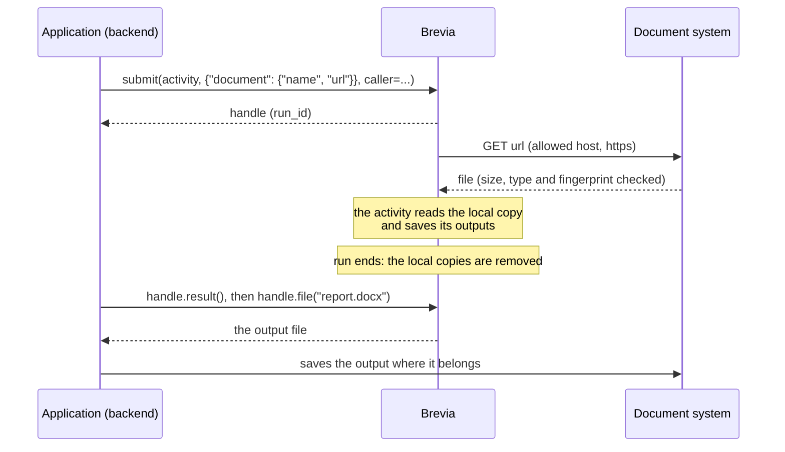

# Files in runs

An activity often works on documents: it reads input files and produces output files.
Brevia keeps neither an archive of documents nor an upload service. The application that
calls Brevia keeps its documents where they live (for example a content management
system), passes their URLs in the input of a run, and takes the outputs back when the
run ends.



What Brevia does and what it leaves to the application:

| Brevia | The application |
|---|---|
| Downloads each input from an allowed host, checks its size, type and fingerprint, keeps it only while the run reads it | Keeps the documents and gives URLs that stay valid for the duration of the job |
| Saves the outputs of a run in the folder of the run and gives a `FileRef` for each | Takes the outputs back and stores them where they belong (for example as media of its document system) |
| Lets only the caller of the job (or an administrator) read its outputs | Takes the outputs it needs within the retention: Brevia removes them `BREVIA_FILES_RETENTION_DAYS` after the run saved them (see [Cleanup](#cleanup)) |

## Settings

| Variable | Default | Meaning |
|---|---|---|
| `BREVIA_FILES_ROOT` | none | Folder of the files of runs. Without it, runs cannot use files (`Unavailable`) |
| `BREVIA_FILES_MAX_BYTES` | `52428800` (50 MiB) | Largest input file |
| `BREVIA_FILES_ALLOWED_EXTENSIONS` | `.pdf,.docx,.xlsx,.pptx,.txt,.md,.csv,.json` | Extensions of the input files accepted |
| `BREVIA_FILES_ALLOWED_HOSTS` | empty | Host names input files may be downloaded from, with `https`; empty allows no download |
| `BREVIA_FILES_RETENTION_DAYS` | `30` | Days the outputs of a run are kept after the last one it saved; `0` keeps them without limit |

The folder must be the same for the processes that run jobs (the workers) and those
that read their outputs, for example a volume shared by the containers.

!!! warning "Allow only the hosts of your documents"
    A caller chooses the URLs of its inputs. If Brevia downloaded from any host, a
    caller could make it read addresses of the internal network. List only the hosts
    that serve your documents, for example the host of the document system.

## Input files

An input field of type [`FileSource`](../reference/files.md#brevia.FileSource) holds an
input file:

```python
from brevia import FileRef, FileSource, RunContext
from pydantic import BaseModel


class ReportRequest(BaseModel):
    data: FileSource
    template: FileSource


class ReportResult(BaseModel):
    report: FileRef


async def build_report(request: ReportRequest, ctx: RunContext) -> ReportResult:
    data = await ctx.files.local_path(request.data)
    template = await ctx.files.local_path(request.template)
    content = render(data, template)  # the work of the activity, with its libraries
    report = await ctx.files.save("report.docx", content)
    return ReportResult(report=report)
```

A source has a descriptive `name`, whose extension gives its type, and either a `url` or,
for trusted code only, a local `path`:

```json
{
  "data": {
    "name": "readings.csv",
    "url": "https://documents.example.org/media/readings.csv?signature=...",
    "sha256": "4f1c...e9",
    "size": 482113
  },
  "template": {"name": "template.docx", "url": "https://documents.example.org/media/template.docx"}
}
```

`sha256` and `size` are optional; when given, the downloaded content must match them.
The name never becomes a path on the server: it must be a single name, without path
separators, and may not start with `.partial-`, the prefix of the files being
written.

When a run or a job is submitted, Brevia checks every source of its input, at any depth
of the input model, and refuses at once (`InvalidInput`, or `FileTooLarge` for a declared
size over the limit):

- a URL that is not `https` or not of an allowed host;
- an extension that is not allowed;
- a local `path` from a caller: local paths are for scripts and tests that run without
  a caller.

To read the text of a PDF, DOCX or text file, `await ctx.files.read(source)` does the
same and returns a `Document` with its sections (see [Documents](documents.md)).

`await ctx.files.local_path(source)` downloads the file (or copies the local path) into
a work folder of the run, the first time it is asked, and returns its path; it keeps
the name, so that libraries that need the extension find it. Redirects are followed,
at most 5, each to an allowed host. The file is checked as it arrives:

| What happens | Error | Retryable |
|---|---|---|
| Larger than `BREVIA_FILES_MAX_BYTES` | `FileTooLarge` | no |
| Content different from the declared `size` or `sha256` | `InvalidInput` | no |
| The server refuses the file (4xx, for example an expired URL) | `InvalidInput` | no |
| The server fails (5xx, 408, 429), cannot be reached, or answers with a malformed redirect | `Unavailable` | yes |
| More than 5 redirects, or a redirect without a location | `InvalidInput` | no |
| A local `path` that does not exist | `NotFound` | no |
| `BREVIA_FILES_ROOT` not set | `Unavailable` | yes |

Errors give the name of the file, never its URL, which may carry a temporary signature;
the requests logged by the HTTP client keep the URL without its query. A file that fails
a check leaves nothing behind. Concurrent calls for the same source download it once;
two sources with the same name get two different paths.

The work folder is removed when the run ends, whether it succeeds, fails or is
cancelled: inputs are not kept by Brevia. A job that starts again after an interruption
downloads them again.

## Output files

`await ctx.files.save(name, content)` saves an output and returns its
[`FileRef`](../reference/files.md#brevia.FileRef): the run, the name, the type, the size and
the SHA-256 fingerprint. `content` is the bytes of the file, or a function that writes
the file at the path it receives, for libraries that save to a path:

```python
report = await ctx.files.save("report.docx", lambda path: document.save(path))
```

The function runs in a thread. The file is written apart and moved into place when
complete: readers see the earlier file or the new one, never a partial one, and a
failed write leaves the earlier file. A thread cannot be stopped: when the run is
cancelled or times out while the function writes, Brevia waits for the thread to end,
does not publish its file, and only then removes the work folder. The same name gives the same file: a job that
starts again saves its outputs again under the same names, without duplicates.

Return the `FileRef` values in the output of the activity, so that the caller finds
them in the result.

## Reading the outputs of a job

```python
handle = brevia.job(run_id, caller=caller)
result = await handle.result()
path = await handle.file(result.report.name)  # read it, do not modify it
```

[`RunHandle.file(name)`](../reference/runs.md#brevia.RunHandle.file) gives the path of the
output, after the [access check](access.md#access-to-runs-and-customisations) of the job:
another caller gets `NotFound`, as for a job that does not exist. The
[HTTP API](http-api.md#results) serves the same file with
`GET /runs/{run_id}/files/{name}`, after the same check.

## Cleanup

The daily cleanup of the workers, and `brevia db cleanup`, remove:

| Folder | When |
|---|---|
| `work/<run_id>`, the inputs of a run | When the run ends; a folder left by a stopped process, one day after its last change |
| `runs/<run_id>`, the outputs of a run | `BREVIA_FILES_RETENTION_DAYS` after the last output the run saved; never with `0` |

`brevia db cleanup --dry-run` counts them without removing anything. A folder that
disappears during the cleanup (a run that ends and removes it) is skipped. A folder
that cannot be removed, for example for a permission, is counted as not removed and
logged as a warning; the others are removed anyway, and `brevia db cleanup` ends with
status 1. A run that lasts
more than a day after its last download may lose its inputs to the cleanup; runs are
expected to last minutes.

## External data that changes

A job that starts again after an interruption runs its activity from the beginning,
with the same input. Data read from an outside system while the job runs may have
changed by then. Read such data before submitting the job and put it in the input
(small data) or pass it as a file with its `sha256` (large data): the activity then
works on fixed values. Effects of the activity on outside systems (writing a record,
publishing a document) must bear being repeated.

## Limits

- No upload and no archive of documents: inputs come from URLs or, for trusted code,
  local paths. An upload can be added when a project needs it, without changing the
  activities, which read `FileSource` values either way.
- Outputs are read through the handle of a job; the outputs of a direct run are in its
  folder, without a reading operation.
- The age of a folder is that of the last file changed in it, not the end of its run
  as recorded in the database.
- The type of a file is given by the extension of its name; its content is not
  inspected.
- Brevia does not save outputs in an outside system: the application takes them back.
