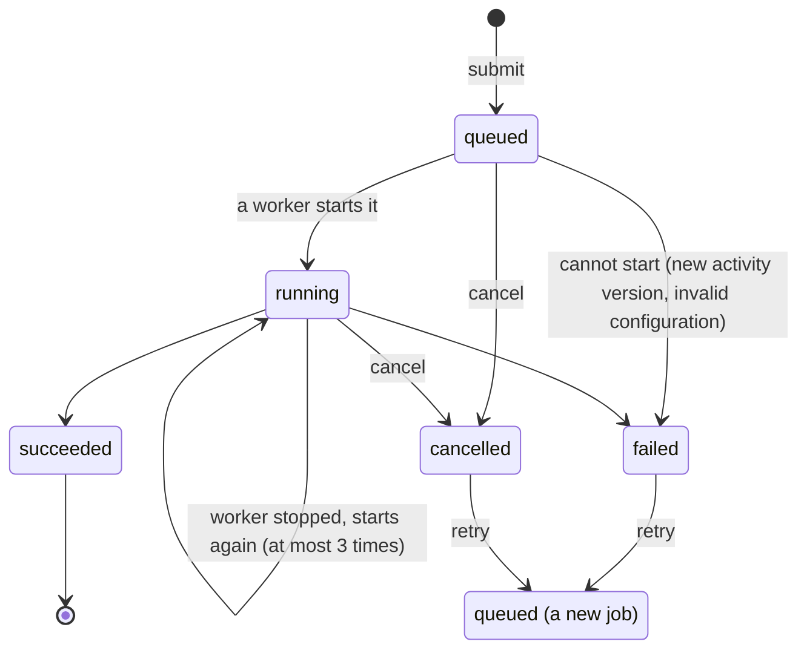

# Running jobs

A job is a durable run of an activity. [`submit`](../reference/application.md#brevia.Brevia.submit)
records and queues it, and returns at once; a separate process, the *worker*, runs it.
The job survives a stop of its worker: it starts again by itself, from the beginning of
its activity, with the same configuration.

This page is for whoever writes the application: how to submit and follow jobs, and how
to write an activity that runs as one. How to start, stop and update the workers is in
[Operating workers](workers.md).

## When to use a job

| | [Direct run](runs.md) | Job |
|---|---|---|
| The caller | Waits for the result in the same call | Gets a handle at once and reads the result later, also from another process |
| A stop of the process during the run | Loses the run: its caller tries again | The job starts again by itself, on its worker |
| A caller that sends the same request twice | Runs it twice | Gets the same job with an [idempotency key](#idempotency) |
| What it needs | A started `Brevia` | A started `Brevia` and at least one [worker](workers.md) |

Use a job when the work is long, must survive restarts, or must not be repeated by a
caller that retries. Use a direct run when the caller waits for the result and can
simply try again.

## A complete example

The activity of [Getting started](../getting-started.md) runs as a job when it declares
the `"job"` mode, alone or with `"direct"`. In `app.py`, register it and nothing else,
since the worker imports this module:

```python
from brevia import Brevia, BreviaSettings, configure_logging
from summary import SummaryConfig, SummaryRequest, SummaryResult, summarize

settings = BreviaSettings()
configure_logging(settings.log_level, settings.log_format)
brevia = Brevia.from_settings(settings)
brevia.register_activity(
    name="document.summarize",
    version="1",
    function=summarize,
    input_type=SummaryRequest,
    output_type=SummaryResult,
    config_type=SummaryConfig,
    prompts={"summary": "prompts/summary.md"},
    overridable=["language"],
    modes=("direct", "job"),
)
```

Start a worker for this application, in another terminal. As in
[Getting started](../getting-started.md), `uv run --env-file .env` makes the `brevia`
command of the project available and gives the provider key to the worker process:

```sh
uv run --env-file .env brevia worker app:brevia
```

Then submit a job and follow it, in `submit.py`:

```python
import asyncio

from brevia import BreviaError, NotReady
from app import brevia
from summary import SummaryRequest


async def main() -> None:
    async with brevia:
        handle = await brevia.submit(
            "document.summarize",
            SummaryRequest(text="The document to summarise..."),
            {"language": "en"},  # overrides, on declared paths
            idempotency_key="summary-2026-10",
        )
        print(handle.run_id)
        state = await handle.status()  # JobState: status, dates, error, usage
        print(state.status)
        try:
            result = await handle.result(wait=60)  # waits up to 60 s
            print(result)
        except NotReady:
            # Still queued or running after 60 s: the job goes on. Stop it instead.
            await handle.cancel()
            retried = await handle.retry()  # a new job, linked to the cancelled one
            print("retried as", retried.run_id)
        except BreviaError as exc:
            # The job failed or was cancelled: result() raised its recorded error.
            if exc.retryable:
                retried = await handle.retry()
                print("retried as", retried.run_id)


asyncio.run(main())
```

Run `submit.py` again and it prints the same identifier: the idempotency key finds the
job submitted the first time.

The input, output and configuration types of a job activity must be defined at module
level: the worker records the values of each step and finds their types by name.
Registration refuses types defined inside a function. Register the activities before
[`start`](../reference/application.md#brevia.Brevia.start): when an activity supports jobs, `start`
also checks the state of jobs in the database, and a `Brevia` started without any job
activity refuses `submit` and `job` with a `RuntimeError`.

## Submitting a job

`submit` refuses at once what a worker could not run: an activity without the `"job"`
mode (`Unsupported`), an invalid input (`InvalidInput`), overrides on undeclared paths
(`OverrideNotAllowed`) or that do not compose into a valid configuration. Input and
overrides are recorded as JSON, and the worker reads them back from that form: values
without a JSON form are refused with `InvalidInput`, and NUL characters are replaced
by U+FFFD, as in the records of direct runs.

Input and output are recorded under the aliases of their fields, without computed
fields, and read back accepting aliases or names. The schemas must accept their own
JSON form: an input that its schema cannot read back (for example a field written
under a `serialization_alias` that its `validation_alias` does not accept) is refused
at submission with `InternalError`, and a job whose output cannot be read back fails
with `InternalError` instead of ending with a result that nobody can read.

The job is recorded and queued in one database transaction: either both happen, or
neither does, and the handle is returned only when both are done.

## Following a job

A [`RunHandle`](../reference/runs.md#brevia.RunHandle) holds only the identifier of the job
and its caller: every method reads the job again. `brevia.job(run_id, caller=caller)`
gives a handle for a job submitted earlier, also by another process; under the
`per-caller` policy a caller finds only its own jobs (see
[Access](access.md#access-to-runs-and-customisations)).

| Method | What it does |
|---|---|
| [`status()`](../reference/runs.md#brevia.RunHandle.status) | The [`JobState`](../reference/runs.md#brevia.JobState): status, activity and version, dates, `error`, `usage`, `retry_of`, and `done` once the job has ended |
| [`result(wait=)`](../reference/runs.md#brevia.RunHandle.result) | The validated output of a succeeded job |
| [`cancel()`](../reference/runs.md#brevia.RunHandle.cancel) | Stops a job that has not ended |
| [`retry()`](../reference/runs.md#brevia.RunHandle.retry) | Submits a new job with the same request, after a failure or a cancellation |
| [`file(name)`](../reference/runs.md#brevia.RunHandle.file) | The path of an output file the job saved (see [Files](files.md#reading-the-outputs-of-a-job)) |

A handle for an identifier that is not a job, or for a job the caller may not see,
raises `NotFound`; when the database or
the state of jobs cannot be read, the methods raise `Unavailable`.

| Status | Meaning |
|---|---|
| `queued` | Accepted, waiting for a worker |
| `running` | Started by a worker; also while it waits to start again after a stop of its worker |
| `succeeded` | Ended with a validated output |
| `failed` | Ended with an error, in `state.error` |
| `cancelled` | Cancelled before it ended |



## Listing jobs

[`brevia.jobs()`](../reference/application.md#brevia.Brevia.jobs) gives a page of
jobs, newest first, as a [`JobPage`](../reference/runs.md#brevia.JobPage): the states
in `jobs` and the `next_cursor` of the next page, `None` on the last one.

```python
page = await brevia.jobs(activity="document.summarize", status="failed", caller=caller)
while True:
    for state in page.jobs:
        print(state.run_id, state.error["code"])
    if page.next_cursor is None:
        break
    page = await brevia.jobs(
        activity="document.summarize",
        status="failed",
        cursor=page.next_cursor,
        caller=caller,
    )
```

| Argument | Meaning |
|---|---|
| `activity`, `status`, `idempotency_key` | Only the jobs that match; all of them when not given |
| `limit` | Jobs in a page, from 1 to 100 (default 20) |
| `cursor` | `next_cursor` of the previous page, with the same filters |

Under the `per-caller` policy a caller lists only its own jobs; trusted code,
administrators and the `shared` policy list every job. A cursor is a position in the
list, not a snapshot: a job submitted meanwhile appears on the first page, not on the
next ones. Before each list, the active jobs it may show are checked against the
job engine in one read per 500 jobs, and those the engine has ended are recorded as
ended: the filter on `status` and the pages see the same statuses as a job read alone.
A cursor that Brevia did not give, or a `limit` out of range, raises
`InvalidInput`.

To get back a job from its idempotency key without submitting it again,
[`brevia.find_job(activity, key, caller=caller)`](../reference/application.md#brevia.Brevia.find_job)
gives its `JobState`, or `None`. Like the key, it is scoped to the caller: the key of
another caller is not found, also by an administrator.

## Waiting, cancelling, starting again, retrying

Four things look alike and are different:

| | Who starts it | What happens to the job | Model calls |
|---|---|---|---|
| **Waiting**: `result(wait=)` | The caller | Nothing: when the time is over, `NotReady` is raised and the job goes on | None |
| **Cancellation**: `cancel()` | The caller | The same job ends as `cancelled` | Those made until then are recorded with the job |
| **Start again** after a stop of the worker | The worker, by itself | The same job runs its activity again from the beginning | **Made and paid again** |
| **Retry**: `retry()` | The caller | A new job, linked to the old one by `retry_of` | Made by the new job |

### Waiting for the result

`result()` returns the output of a succeeded job. For a failed job it raises the
recorded error (for example `OutputInvalid`), for a cancelled one `Cancelled`, and
while the job has not ended `NotReady`. With `wait`, it waits up to that many seconds
for the job to end, reading it about four times a second; waiting does not change the
job.

### Cancellation

`cancel()` stops a job that has not ended and records it as `cancelled`. Calling it
again is safe: it changes nothing on a job already cancelled or ended, and completes a
cancellation whose earlier call did not reach the job engine. A queued job never
starts. A running job is stopped within about a second, also in the middle of a model
call: its activity receives a cancellation, as a direct run whose task is cancelled,
and the model calls made until then are recorded with the job, with their usage.
Effects already produced are not undone. A call stopped before the model answered may
miss its last request in the usage: the model adapter counts a request when it is
answered.

### Starting again after a stop of the worker

A job runs in two recorded steps: the resolution of configuration and prompts, and the
run of the activity, which records its outcome and its model calls at its end, as a
direct run does. When a worker stops during the run (a crash, a restart, a shutdown
that does not wait for the job), the job is not lost: when a worker with the same
identifier and version starts again, the job starts again from the beginning of its
activity, with the configuration and prompts resolved at its first start.

!!! warning "A job that starts again repeats and pays its model calls"
    The model calls of the lost execution are made again, and the provider bills them
    again. They are not recorded: the calls, usage and cost of the job are those of the
    execution that reached the end. Write the activity so that a second execution is
    harmless (see [below](#writing-an-activity-that-can-start-again)).

- A job is started again at most 3 times; then the engine ends it, and it is recorded
  as `failed`, to be retried. Each start costs its model calls, so a job that stops its
  worker every time (for example by using all its memory) does not run forever.
- A job started again after its deadline fails with `RunTimeout` (see
  [below](#values-fixed-when-the-job-starts)).
- A job interrupted under one application version does not start again on a worker of
  another version: see [Releases](workers.md#releases).

### Retry

`retry()` submits a new job linked to a failed or cancelled one (`state.retry_of`),
with the same input and overrides, for the version of the activity registered now;
configuration and prompts are read again. It belongs to the caller of the failed job
and accepts its own `idempotency_key`. A job
that has not ended raises `Busy`; a succeeded job raises `Unsupported`. An input no
longer valid for the activity raises `InvalidInput`, and an activity no longer
registered `NotFound`.

## Idempotency

With an `idempotency_key`, a submission repeated by a caller that lost the response
gets the same job, in whatever status it is, also `failed`. The input is validated
again, the configuration is not: a later customisation does not prevent finding the
job. The same key with a different request (activity version, input or overrides)
raises `IdempotencyConflict` (HTTP 409), with the identifier of the existing job in
`details["run_id"]`.

A key is scoped to the [caller](access.md#idempotency-keys-belong-to-their-caller) and
the activity: the same key on two activities, or of two callers, gives two jobs. It
lives as long as its job: to run the same request again, use a new key or
[`retry`](#retry). A key is a non-blank string of at most 200 characters, without NUL characters; any other
value raises `InvalidInput`.

## Values fixed when the job starts

The worker resolves the configuration and the prompts in the first step of the job,
with the customisations stored at that moment, and records them in the
[snapshot](runs.md#snapshots), with the application version of the worker. A queued
job therefore uses the customisations made while it waited, and fails without running
its activity if they no longer compose into a valid configuration. Once it has
started, it keeps those values until it ends, also when it starts again after an
interruption: later changes apply to the next jobs.

The limits of the activity apply to each execution of the job. Its maximum duration,
`max_seconds`, counts from its first start, recorded as a deadline: a job that starts
again does not get its time again, and one that starts again after its deadline fails
with `RunTimeout`.

## Writing an activity that can start again

Because a job may run its activity more than once, an activity that runs as a job
makes its effects repeatable:

- **Write to a name derived from `ctx.run_id`**, or use an idempotency key when it
  calls another service, so that a second execution overwrites the same thing instead
  of adding another one.
- **Take what it works on from the input and the configuration.** They are fixed when
  the job starts; data read from elsewhere (a folder, another service, the current
  time) may have changed when the job starts again. When that matters, read it before
  submitting the job and pass it in the input.
- **Change the code with a new version.** A new `version` of the activity makes the
  queued jobs of the old one fail, to be retried (see
  [Releases](workers.md#releases)).

```python
from pathlib import Path

from pydantic import BaseModel

from brevia import RunContext

OUTPUT = Path("reports")


class Section(BaseModel):
    title: str
    text: str


class ReportRequest(BaseModel):
    sections: list[Section]  # the text itself, read before the job was submitted


class ReportConfig(BaseModel):
    model: str


class SectionSummary(BaseModel):
    summary: str


class Report(BaseModel):
    path: str
    sections: list[SectionSummary]


async def report(request: ReportRequest, ctx: RunContext[ReportConfig]) -> Report:
    summaries = []
    for section in request.sections:  # from the input: the same on every execution
        summary = await ctx.model().generate(
            instructions=f"Summarise the section {section.title!r}.",
            user_text=section.text,
            output_type=SectionSummary,
        )
        summaries.append(summary)
    OUTPUT.mkdir(exist_ok=True)
    path = OUTPUT / f"{ctx.run_id}.md"  # the same name on every execution
    path.write_text("\n\n".join(s.summary for s in summaries), encoding="utf-8")
    return Report(path=str(path), sections=summaries)
```

The recorded steps hold the input and the resolved configuration and prompts, in the
schema of jobs, whatever the capture mode of the activity. They are deleted
`retention_days` after the job ends (see [Cleanup](workers.md#cleanup)); a rule for
the other copies of the data is to be defined before production use (see
[Recorded runs](runs.md#contents-of-model-calls)).

## Errors a job can end with

A failed job records `{code, message, details, retryable}` in `state.error`, and
`result()` raises the same error. Besides the [run failures](errors.md#run-failures)
of any run (`RunTimeout`, `LimitExceeded`, `OutputInvalid`, `ProviderError`...), a job
can end with:

| Error | When | Retryable |
|---|---|---|
| `Cancelled` | The job was cancelled | No |
| `Unsupported` | The version of its activity changed before the job started | Yes |
| `InvalidInput`, `OverrideNotAllowed`, `Unavailable` | Configuration or prompts could not be resolved when the job started | As raised |
| `InternalError` | The job was interrupted by a release, its worker stopped more than 3 times, or it ended without recording its outcome | Yes |
| `InternalError` | An unexpected exception in the activity | No |

Retry the retryable ones with `retry()`: an error marked not retryable is likely to
happen again with the same request.

## Limits

- A job is read from its record. When the engine ended a job without recording its
  outcome (for example when the record could not be written), the record is corrected
  the next time the job is read, or by the [cleanup](workers.md#cleanup).
- Only jobs are listed: direct runs, also when recorded in `runs`, are not in the pages of
  `jobs()`.
