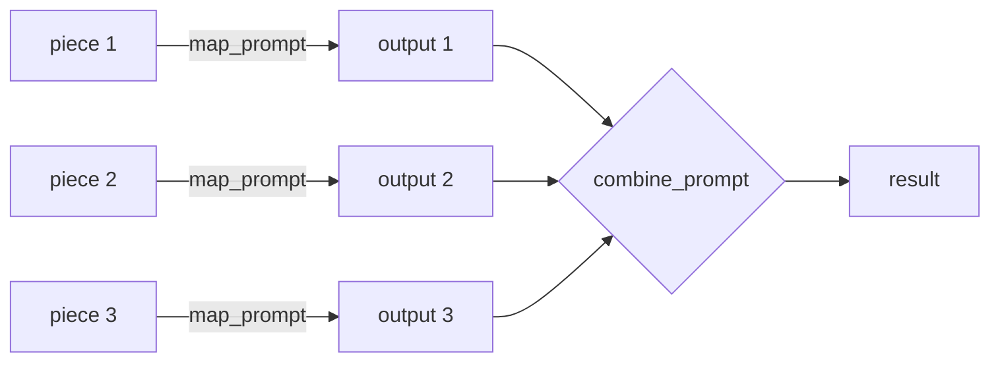
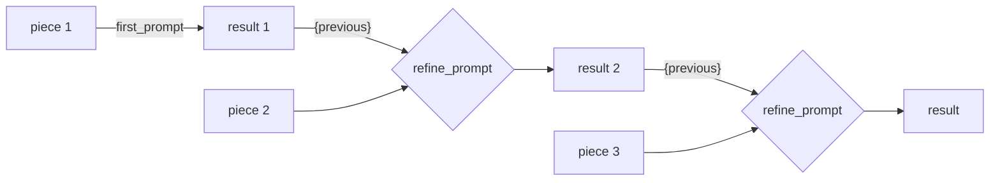
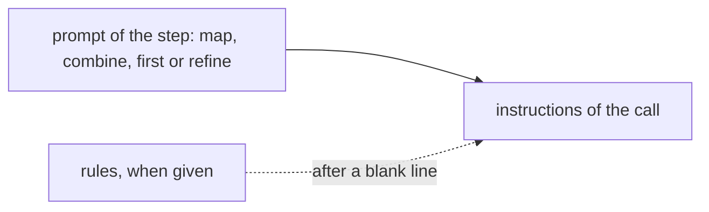

# Pipelines

A pipeline is the code of an activity that runs several steps: read a document, divide
it, call the model on each part, check, combine. Brevia has no chain objects: a
pipeline is an ordinary `async` function, and Brevia gives the pieces it is built from.

| Level | What it gives | Use it when |
|---|---|---|
| Building blocks | `ctx.files.read`, `split`, `ctx.model().generate` | You write every step yourself |
| Strategies | `brevia.analysis.map_reduce` and `refine` | A document is longer than one call, with your prompts and output types |
| Ready activities | [`summarize` and `extract`](analysis.md) | You only need to register them |

Each step is an ordinary `generate` call, so every pipeline gets the same guarantees:

- the output is validated, and the problems found by a validator are sent back to the
  model for another attempt;
- all calls share the limits of the run (requests, tokens, time), and a pipeline that
  goes over them stops with `LimitExceeded` instead of spending without control;
- every call is recorded with the run, with its usage and cost;
- a cancelled run stops within about a second, also in the middle of a call;
- as a job, the pipeline starts again from the beginning if its worker stops.

## Building blocks

```python
async def report(request: ReportRequest, ctx: RunContext[ReportConfig]) -> Report:
    document = await ctx.files.read(request.file)
    parts = []
    for piece in split(document, ctx.config.max_input_chars):
        parts.append(
            await ctx.model().generate(
                instructions=ctx.prompt("chapter").render(),
                user_text=piece.text,
                output_type=Chapter,
                validator=check_numbers,
            )
        )
    return Report(chapters=parts)
```

See [Documents](documents.md) for `ctx.files.read` and `split`, and
[Models and limits](models.md) for `generate`.

## Strategies

Both strategies take the pieces of a document (or plain texts), the prompts of the
activity and an output type, which may be a text summary or a schema of the project.
They have no prompts of their own: the prompts are those declared by the activity, so
they can be changed in the project files or customised in the database, and are
recorded in the snapshot of the run.

### `map_reduce`

An output for each piece, then one call that combines them.



```python
from brevia.analysis import map_reduce

summary = await map_reduce(
    ctx,
    split(document, 100_000),
    output_type=Summary,
    map_prompt=ctx.prompt("summarize"),
    combine_prompt=ctx.prompt("combine"),
    values={"language": "it"},
    max_chars=100_000,
)
```

- Each piece is the user text of a call with `map_prompt`. The partial outputs, as text
  (JSON for a model) separated by blank lines, are the user text of a call with
  `combine_prompt`.
- With `max_chars`, partial outputs that together are longer are combined in groups of
  consecutive outputs within `max_chars`, and the results combined again, until one is
  left. When an output alone is longer than `max_chars`, or no two outputs fit
  together, the run stops with `LimitExceeded` before the calls of that round: ask for
  shorter partial outputs (`max_output_tokens`) or raise `max_chars`.
- `partial_type` gives the partial outputs a type different from the result, for
  example notes per piece and a final report. Without it, one piece needs no
  combination.
- `validator` checks every output of the type of the result: the combinations, and the
  partial outputs when they have that type.
- Calls run one after the other.

### `refine`

An output from the first piece, then updated with each following piece.



```python
from brevia.analysis import refine

terms = await refine(
    ctx,
    split(document, 60_000),
    output_type=ContractTerms,
    first_prompt=ctx.prompt("terms"),
    refine_prompt=ctx.prompt("terms_update"),
    values={"party": request.party},
    validator=check_terms,
)
```

The refine prompt receives the result so far in its `{previous}` variable, JSON for a
model:

```markdown
Update the terms of the contract for {party} with the new part of the document.
Keep the terms already found unless the new part changes them.

Terms found so far:
{previous}
```

- Every step is validated, so the result is valid after each piece.
- It suits outputs that collect facts across a document (an extraction), and texts that
  must follow the thread of the document. It costs one call per piece, in order.
- `values` must not contain `previous`.

### Rules of the project (optional)

Each strategy uses two prompts, and a rule of the project, such as "only facts about
costs", would have to be written in both. `rules` is a prompt of the activity, without
variables, added after the prompt of every call:

```python
summary = await map_reduce(
    ctx,
    split(document, 100_000),
    output_type=Summary,
    map_prompt=ctx.prompt("summarize"),
    combine_prompt=ctx.prompt("combine"),
    values={"language": "it"},
    rules=ctx.prompt("cost_rules"),  # prompts/cost-rules.md, declared by the activity
)
```



Without `rules` the instructions are the prompt of the step alone. Every prompt, also
`rules`, stays a prompt of the activity: it can be replaced by a file or customised in
the database, and it is recorded in the snapshot of the run. This is an option of
Brevia, not a pattern of other frameworks: the prompts of each step are enough when
there are no shared rules.

### Errors

| Error | When |
|---|---|
| `ValueError` | No pieces, `max_chars` not positive, `values` containing `previous` (refine) |
| `InvalidInput` | A prompt has variables different from those given, or `rules` has variables; checked before the first call |
| `LimitExceeded` | Also when the partial outputs of `map_reduce` are too long to combine within `max_chars` |
| `OutputInvalid`, `LimitExceeded`, `RunTimeout`, `ProviderError` | As for `generate`, from any step |

### Choosing

| Need | Strategy |
|---|---|
| The document fits one call | `generate` with `document.text` |
| A summary of a long document | `map_reduce`: parts are independent, the combination sees all |
| Facts collected across a long document into one schema | `refine` |
| A text that follows the order of the document | `refine` |
| Anything else | Building blocks, in your own code |

The reference is in [Analysis](../reference/analysis.md).

## Runnable examples

See [the executable analysis example](analysis-example.md) for a complete application with a fake model. Model-selected file operations are described in [Tools](tools.md).
