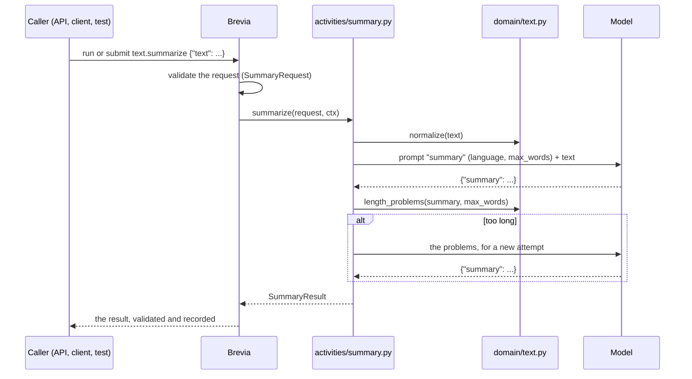

# Project template

The repository has a [Copier](https://copier.readthedocs.io/) template that generates
an application built on Brevia: one working activity, organised as a real project, with
its HTTP API, a worker, a caller, tests with a fake model and a development database.
Start a new project from it; [Getting started](../getting-started.md) builds the same
pieces by hand, to show each of them.

## Generate a project

```sh
uvx copier copy --vcs-ref v1.0.0b1 gh:nikazzio/brevia-next my-project
```

`--vcs-ref` chooses the release of the template: Copier takes the latest stable tag by
default and ignores beta tags such as `v1.0.0b1`, so without it the template comes from
the latest commit of the repository. The generated project installs Brevia from the
same commit as the template, so the two always match.

The repository is private: the command needs read access to it. Copier asks a few
questions and writes the project in `my-project/`; its `README.md` lists the commands.

| Question | Default | Meaning |
|---|---|---|
| `project_name` | `My Brevia application` | Name of the project, in its README |
| `project_slug` | from the name, `my-brevia-application` | Folder and distribution name |
| `package_name` | from the slug, `my_brevia_application` | Python package under `src/` |
| `description` | `An application built on the Brevia library` | One line, in the README and `pyproject.toml` |
| `author_name`, `author_email` | empty | Authors in `pyproject.toml` |
| `brevia_source` | `git+https://github.com/nikazzio/brevia-next@<commit of the template>` | Where to install Brevia from: the Git repository at a tag or commit, or `file:///path/to/brevia-next` for a local checkout |
| `model` | `openai:gpt-6-luna` | Model of the example activity, as `provider:name` |

With `file:///path/to/brevia-next`, uv may reuse a build of Brevia from its cache, since
the version of a checkout does not change between commits: after updating the
checkout, run `uv sync --reinstall-package brevia` in the project. A Git source pinned
to a revision does not have this problem.

The development database of `compose.yaml` listens on port 5432; set `DB_PORT` to start
it on another port, and change `BREVIA_DATABASE_URL` in `.env` to match.

The answers are kept in `.copier-answers.yml` of the project. To take the changes of a
newer template, run in the project:

```sh
uvx copier update --vcs-ref v1.0.0bN
```

Copier merges the changes of the template with those made in the project and marks
the conflicts, as Git does. The answers are kept, `brevia_source` included: to move
Brevia to the same release, give it again
(`--data brevia_source=git+https://github.com/nikazzio/brevia-next@v1.0.0bN`) or change
the dependency in `pyproject.toml`, then run `uv lock`.

## What the project contains

```text
brevia.toml                       project file read by Brevia: models, limits, activity defaults
prompts/summary.md                the prompt of the example activity
src/<package>/
  application.py                  creates Brevia and registers the activities
  activities/summary.py           the activity text.summarize: the code that uses Brevia
  domain/text.py                  the logic of the application, without Brevia
  schemas.py                      request, configuration and result of the activity
  api.py                          the HTTP API: the endpoints of Brevia and of the application
client.py                         a caller in Python: runs the activity, submits a job, reads it
tests/                            tests with a fake model
compose.yaml, .env.example        development database and settings; the application in a container (profile "app")
Dockerfile, bin/start             the image of the application and the script that starts it
```

The parts are kept apart so that each has one reason to change:

- **`application.py`** is the only place where Brevia is created and the activities
  are registered. The worker (`brevia worker <package>.application:create`), the API,
  the client and the tests all start from it, so they run the same activities with the
  same settings.
- **`activities/`** holds the code that runs inside a run or a job. It is the only code,
  with `application.py`, that imports Brevia: it reads the configuration, renders the
  prompt, calls the model and checks its output.
- **`domain/`** holds the rules of the application that do not need a model: preparing
  a text, counting words, checking a result. It does not import Brevia (a test checks
  it), so it is tested alone and can be reused outside the activities.
- **`schemas.py`** declares what a caller sends, the settings of the activity and what
  it returns, as Pydantic models: Brevia validates the request before a run and the
  result before returning it.
- **`prompts/`** holds the instructions for the model, one file per prompt, with the
  variables between braces. They are not in the code so that they can be edited alone,
  checked (a missing or extra variable is an error) and
  [customised](prompts.md#customisation) by an administrator without a release.

## The example activity

The activity `text.summarize` summarises a text. It is the smallest case that uses
what a real application needs: input and output schemas, a prompt with variables, a
configuration with defaults, a check of the output with a new attempt, logic kept in
`domain/`, and both direct runs and jobs.



The prompt, `prompts/summary.md`:

```text
Summarise the text in {language}, in at most {max_words} words.
Keep the main facts, the numbers and the uncertainties.
Do not add information that is not in the text.
```

`language` and `max_words` come from the configuration: the defaults are in
`SummaryConfig` (`schemas.py`), the values of the project in `brevia.toml`
(`[activities."text.summarize"]`), an administrator may customise them, and a request
may override `language` only, since it is the only path declared as `overridable`. See
[Configuration](configuration.md) for the order in which they apply.

To add an activity, copy the pattern: a module in `activities/` with its `register`
function, its schemas, its prompts, its section in `brevia.toml`, and one line in
`application.create`.

## Run it

```sh
cp .env.example .env              # then set the token secret and the provider key
docker compose up -d --wait       # development database
uv sync
uv run brevia db upgrade          # Brevia schemas; again after every upgrade of Brevia
```

| What | Command |
|---|---|
| A direct run from Python | `uv run --env-file .env python client.py run text.txt` |
| A worker, for jobs | `uv run --env-file .env brevia worker <package>.application:create` |
| A job from Python | `uv run --env-file .env python client.py submit summary-1 text.txt` |
| The HTTP API | `uv run --env-file .env uvicorn <package>.api:app --reload` |
| A token for a caller | `uv run --env-file .env brevia token create --user my-frontend` |

`api.py` builds the app with [`create_app`](http-api.md#the-application) and adds one
endpoint of the application, `POST /summaries`, which submits the activity as a job
for the caller of the token and answers `202` with its `run_id`. The caller follows
the job with `GET /runs/{run_id}` and reads it with `GET /runs/{run_id}/result`, two
endpoints of Brevia. The interactive documentation is at `/docs`.

With `BREVIA_FAKE_MODELS=true` in `.env` every model call is answered by a
[fake](testing.md): no provider key and no cost, for local runs.

### In a container

The `Dockerfile` builds an image of the application from `uv.lock` (Python 3.12, uv,
[tini](https://github.com/krallin/tini) as the first process), without secrets: the
settings come from the environment of the container. Its entry point, `bin/start`,
runs what `APP_MODE` asks:

| `APP_MODE` | Runs |
|---|---|
| `all` (default) | The worker and the API in the same container |
| `api` | The API only, on `PORT` (8000) |
| `worker` | The worker only |
| `migrate` | `brevia db upgrade`, then exits; the other modes never migrate |

In `all`, a stop (`TERM` or `INT`) is passed to both processes, and the script waits
until both have ended, so the worker can finish its jobs. When one of them ends on its
own, even with code 0, the script stops the other and exits with an error, so the
platform starts the container again: a dead worker does not leave an API that accepts
jobs nobody runs. Another mode runs its command in place of the script.

```sh
docker build -t my-project .                              # the image, for a platform

# Locally, with the database of compose.yaml: build first, so the migration runs the new code.
docker compose --profile app build
docker compose --profile app run --rm -e APP_MODE=migrate app
docker compose --profile app up
```

The build needs Brevia from a package index or a Git URL it can reach, not a `file://`
path, and a uv in the `Dockerfile` that reads the `uv.lock` of the project. The image
runs as root, so that it can write the files of runs to volumes that platforms mount
as root. [Running in production](production.md#start) lists the settings of the
container and the two ways to deploy it.

## Tests

```sh
uv run pytest
```

| Test | Needs |
|---|---|
| `test_domain.py`: the logic without Brevia | nothing |
| `test_structure.py`: `domain/` does not import Brevia | nothing |
| `test_api.py`: the app has the endpoints of Brevia and of the application, and asks for a token | nothing: the app is not started |
| `test_summary.py`: the activity with a fake model | the database; skipped without it |

Brevia records every run in its database, also in tests, so the tests that run an
activity need the database of `compose.yaml`.

## Compared with Brevia 0.15

Brevia 0.15 had a separate Cookiecutter template, `brevia-cookiecutter`. This template
lives in the repository of the library, so it changes with the library in the same
pull request, and uses Copier because `copier update` brings the changes of the
template to the projects already generated, which Cookiecutter cannot do.

In Brevia 0.15 the repository was also the application, and its image started the API
alone, with jobs in the same process, lost at every restart. Brevia 1.0 is a library:
each project generates its application from this template, and its image runs the
worker of the durable jobs next to the API.

Moving a project from 0.15 to 1.0 is not an automatic upgrade. Generate an application
from this template, then bring the services of the project over as activities and its
prompts as prompt files. The tokens of 0.15 stay valid when the installation keeps the
same secret (see [Authentication](access.md#authentication)); the endpoints of 0.15 and
those of 1.0 are compared in [HTTP API](http-api.md#compared-with-brevia-015).

## Document summary from the library

The application also registers `document.summarize` with the library's readers,
packaged prompts and `SummarizeConfig`. Use `POST /runs` with
`{"activity":"document.summarize","mode":"job","input":{"text":"A document."}}`,
or pass a PDF, DOCX or UTF-8 text file by URL:
`"input":{"file":{"name":"report.pdf","url":"https://docs.example.org/report.pdf"}}`.
Files need `BREVIA_FILES_ROOT` and the host of the URL in `BREVIA_FILES_ALLOWED_HOSTS`
(see `.env.example`); without them the run fails with `unavailable` or `invalid_input`.
Its defaults are in the `activities."document.summarize"` section of `brevia.toml`.
The original `text.summarize` remains the example of domain checks written by the
project; `/summaries` submits that custom activity.
