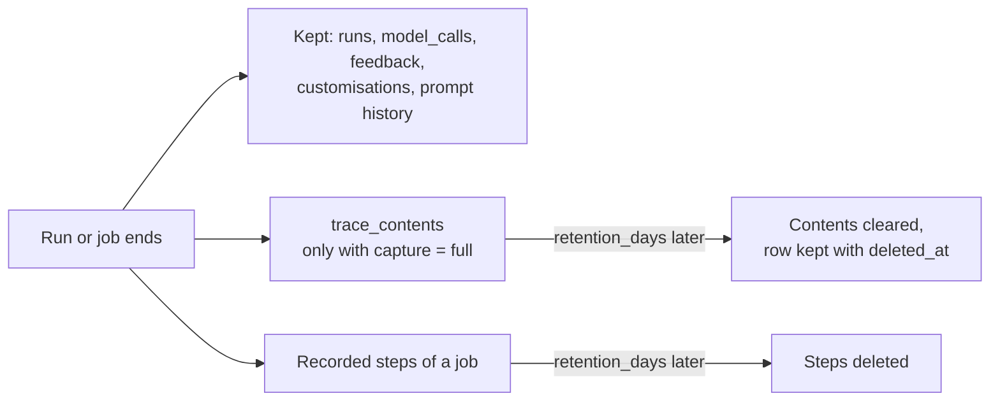

# Recorded runs

Read this page to start and stop Brevia around runs, to know what a run leaves in the
[database](database.md), how long it stays there, and what happens when it cannot be
recorded.

Brevia records every run, job or direct (unless `BREVIA_RECORD_DIRECT_RUNS=false`): what
was asked, the values in use, the outcome and the usage of each model call. The records are meant for diagnosis and cost analysis, and
they are the runs that [feedback](#feedback) refers to.

## Lifecycle

`Brevia` must be started before running activities, and stopped at the end:

```python
brevia = Brevia.from_settings()
brevia.register_activity(...)  # as in Getting started

async with brevia:
    result = await brevia.run("document.summarize", {"text": "..."})
```

or, when the application manages its own lifecycle (for example in a FastAPI
lifespan), with `await brevia.start()` and `await brevia.stop()`. Register activities
before `start`: the job engine starts only when a registered activity has the `job`
mode, and jobs on a Brevia started without one raise `RuntimeError`. An activity with
only the `direct` mode may also be registered after `start`. `run` on a Brevia that is
not started raises `RuntimeError`.

`stop` refuses new runs at once and waits for the outcome writes already under way,
then closes the connections. Call it when runs have ended: a run still working when
Brevia stops cannot record its outcome and fails with `Unavailable`.

## What is recorded

At the start of a run, before the activity is called, a row of `runs` with status
`running`:

- the activity, its version and the mode (`direct`);
- the [caller](access.md) and the end user it acts for, when given;
- the validated input;
- the snapshot: resolved configuration, prompts with their fingerprints, declared
  models with prices, limits, model adapter and Brevia version (see
  [Snapshots](#snapshots)).

At the end, in one transaction:

- the status: `succeeded`, `failed` or `cancelled`;
- the output, or the error as `{code, message, details, retryable}`; for an
  unexpected exception only its type is kept, as in the logs;
- the usage of the run: requests, tokens and estimated cost;
- one row of `model_calls` per model call, in order: model, adapter, effective
  options (reasoning, temperature and maximum output tokens, which overrides and
  `max_output_tokens` may have changed from the snapshot), attempts, tokens, estimated
  cost with the prices used, duration, start time and error code.

The run identifier is the key of the row and the `run_id` of the log records of the
run. Snapshots and records contain no credentials.

## Snapshots

The snapshot records what a run uses, at its start, so that the run can be understood
afterwards even if the project or the customisations have changed in the meantime. For
the activity `document.summarize` of the project used by the unit tests, with the
override `{"language": "en"}`:

```json
{
  "format": 2,
  "application": {"version": "2026.10.1"},
  "activity": {"name": "document.summarize", "version": "1"},
  "config": {"model": "openai:test-model", "max_output_tokens": 1200, "language": "en"},
  "model_overrides": {},
  "prompts": {
    "summary": {
      "text": "Summarise the document in {language}. Do not add information.",
      "source": "summary.md",
      "sha256": "6cbc2afd…",
      "version": null
    }
  },
  "models": {"openai:test-model": {"reasoning_levels": ["low"], "prices": {"input": "1", "output": "2"}}},
  "limits": {"max_requests": 5, "max_tool_calls": 0, "max_total_tokens": 0, "max_seconds": 900.0, "provider_retries": 2},
  "adapter": {"name": "pydantic-ai", "version": "2.55.0"},
  "library": {"name": "brevia", "version": "1.0.0b1"},
  "capture": {"mode": "metadata", "retention_days": 7}
}
```

(Some fields of `models` are left out here.)

| Key | Content |
|---|---|
| `format` | Version of this layout |
| `application` | Version of the application (`BREVIA_APP_VERSION`). For a direct run `version` is `null` when it is not set; a job records the version its worker runs it under, the version of Brevia by default (`brevia-1.0.0`) |
| `activity` | Name and version of the activity |
| `config` | Resolved configuration, by alias |
| `model_overrides` | Model options overridden by the request |
| `prompts` | Text, source, fingerprint and customisation version (`null` for the file) of each prompt |
| `models` | Declared capabilities and prices of the models of the project |
| `limits` | Limits of the run |
| `adapter`, `library` | Versions of the model adapter and of Brevia |
| `capture` | Capture mode and retention of call contents |

`config` is the serialised form of the configuration: a field declared with
`Field(exclude=True)` does not appear in it, and custom serialisers apply. A run takes
its limits, models and prompts from the snapshot it builds at its start, and receives
the configuration as the validated object; the snapshot recorded in the database is
never read back to rebuild a run. The snapshot of a [job](jobs.md) is empty while it is
queued and written when it starts (see
[Values fixed when the job starts](jobs.md#values-fixed-when-the-job-starts)).

## When recording fails

Recording is part of the run, not a side effect:

- if the start cannot be recorded, the activity is not called and `run` raises
  `Unavailable`;
- if the outcome cannot be recorded, `run` raises `Unavailable` even when the activity
  succeeded: its output is not returned, so that no result exists without its record.
  When the activity had failed, its error is kept as the context of `Unavailable`;
- if a cancelled run cannot be recorded, a warning is logged and the cancellation
  goes on.

The write of the outcome is shielded from cancellation, so a run cancelled at that
moment is still recorded with its real outcome; if that write then fails, the failure
is logged with the types of its causes.

Records are JSON in PostgreSQL, which refuses values without a JSON form, non-finite
numbers (`NaN`, infinities) and the NUL character (U+0000; the six characters `\u0000`
written as text are ordinary text). NUL characters, frequent in text extracted from
documents, are replaced by U+FFFD in the records (input, output, errors and call
contents); the caller still receives the output unchanged. For the other values:

- such a value in the input or in the configuration refuses the run with
  `InvalidInput`, before the activity is called;
- in the output, the run fails with `InternalError` and is recorded as failed;
- in the details of an error, the details are dropped and the rest of the error is
  recorded.

The time spent recording the start of a run does not count against its
`max_seconds`.

Recording can be disabled with `BREVIA_RECORD_DIRECT_RUNS=false`, for example in
tests; `start` is still needed, since the database is required.

## Contents of model calls

By default only the usage of each model call is recorded. An activity that needs its
calls reviewed or analysed records their contents too:

```python
brevia.register_activity(..., capture="full")
```

For each call, including the calls that failed, a row of `trace_contents` keeps the
rendered instructions, the user text and the validated output as JSON. For a call that
failed, the output is empty: the invalid answers of the model are not kept, only the
error code of the call. NUL characters, which PostgreSQL refuses, are replaced with
U+FFFD.

Contents are written with the outcome of the run: with
`BREVIA_RECORD_DIRECT_RUNS=false` nothing is recorded, contents included. They never
appear in logs and contain no credentials; they do contain the documents and data sent
to the model, so they expire after the days set in the project file:

```toml
[traces]
retention_days = 30   # the default 0 keeps them without a time limit
```

The capture mode and the retention are recorded in the snapshot. What expires and what
stays is described in [Data retention](#data-retention).

## Data retention

`[traces] retention_days` applies to the contents of model calls and to the recorded
steps of jobs; with `0`, the default, they are kept too. The other records are always
kept:

| Data | Where it is stored | When it is deleted |
|---|---|---|
| Run: input, snapshot (with the prompt texts), result or error, usage | `runs` | Never, today |
| Metrics of each model call: model, options, tokens, cost, duration, error code | `model_calls` | Never, today |
| Contents of each model call: instructions, user text, output; only with `capture="full"` | `trace_contents` | Cleared `retention_days` after the end of the run; with `0` no expiry is recorded (`expires_at` empty) and they are kept. A cleared row stays with its expiry and the time of the deletion (`deleted_at`), so that a reader can tell that the contents existed |
| Recorded steps of a [job](jobs.md): input, configuration and prompts, whatever the capture mode | Schema of jobs (`BREVIA_JOBS_SCHEMA`, `dbos` by default) | Deleted `retention_days` after the job ends; steps of jobs that have not ended are never deleted |
| Input files of a run | Work folder under `BREVIA_FILES_ROOT` | Removed when the run ends; a folder left by a stopped process, a day after its last change |
| Output files of a run | `BREVIA_FILES_ROOT/runs` | Removed `BREVIA_FILES_RETENTION_DAYS` (30) after the last output the run saved; kept without limit with `0` |
| Customisations of the configuration | `configurations` | Kept; changed only by a customisation or a reset |
| Customised prompts and their history | `prompts`, `prompt_revisions` | Kept; history rows are only added |
| [Feedback](#feedback) on a run: corrections or a rating, comment, external reference, caller | `feedback` | Kept; rows are only added |



Expired data is deleted every night by a job worker, or by `brevia db cleanup` (see
[Cleanup](workers.md#cleanup)). Without a worker, expired data stays until the command is
run; with one, it stays at most about a day after its expiry.

A rule for the data kept without expiry, which includes the documents in the input of
runs and the prompt texts of their snapshots, is planned before the first production
use.

## Feedback

The people who use an output can correct it or rate it. [`brevia.add_feedback`](../reference/application.md#brevia.Brevia.add_feedback)
records the feedback with the run, direct or job:

```python
from brevia import Caller

caller = Caller("bedita-backend", end_user="user-42")

# Corrections: what the run generated and what the user changed it to.
await brevia.add_feedback(
    run_id,
    {
        "kind": "correction",
        "items": [
            {
                "target": "summary",
                "original": "Revenue grew.",
                "corrected": "Revenue grew by 4%.",
            }
        ],
        "external_ref": {"system": "bedita", "object_id": "42", "revision": "3"},
    },
    caller=caller,
)

# A rating, with an optional comment.
await brevia.add_feedback(
    run_id, {"kind": "rating", "rating": "bad", "comment": "Too short."}, caller=caller
)
```

| Field | Meaning |
|---|---|
| `kind` | `correction` (with `items`) or `rating` (with `rating`) |
| `source` | Who gave it: `user` (the end user of an application, the default), `reviewer` (a person who reviews outputs) or `automatic` (a check run by a program or a model) |
| `items` | Corrections, 1 to 500: `target` (the part of the output, as the project names it), `original`, `corrected` |
| `rating` | `good` or `bad` |
| `comment` | Free text, with either kind |
| `external_ref` | Opaque reference to the final document of the project, string values only |

Feedback is only added, in the `feedback` table: a later feedback never replaces an
earlier one, and the output of the run is not changed. The caller and its end user are
recorded with it. Brevia keeps the differences and the reference, not the final
document: comparing a draft with the version a user uploaded again, to find the
corrections, is the work of the project.

A backend that may send the same feedback twice, for example when it repeats a request
whose answer it did not receive, passes an `idempotency_key`: with the same key, the
same caller and the same run, the feedback already recorded is returned and nothing is
added. The same key with different feedback, or for another end user, raises
`IdempotencyConflict` with the `feedback_id` of the recorded one. A key is a non-blank
string of at most 200 characters, without NUL characters.

```python
await brevia.add_feedback(
    run_id, correction, idempotency_key="doc-42-revision-3", caller=caller
)
```

Under the `per-caller` policy a caller adds feedback only to its own runs; another
run, an identifier that is not a run and a direct run that was not
[recorded](#what-is-recorded) raise `NotFound`. Feedback that does not match its kind,
or holds a NUL character, raises `InvalidInput` without the values.

## Limits

- One `model_calls` row covers a call with all its attempts. Its `request_records`
  list each request to the provider, also the failed and cancelled ones: provider,
  requested and returned model, requested and applied options, identifiers of the
  response and of the request (the request only for OpenAI and Anthropic), HTTP status, reason of the end, tokens (reasoning and
  cache included) and whether the usage was reported. Contents (instructions, text,
  answers, tool arguments) and error bodies are never in these records.
- In the totals of a row, token counters a provider does not report are zero; the
  request records say when the usage was not reported, and the cost is then unknown;
  an error answer of the provider (for example a rate limit) has usage `none` and
  leaves the cost known.
- If the process stops during a run, the row stays `running` and the usage of that
  run is lost: direct runs are not durable; use a [job](jobs.md) for that.
- There is no public API to read or list direct runs; jobs are read with their handle
  or listed with `Brevia.jobs`. To know the identifier of a direct run, for example
  to add feedback, pass a new one as `run_id=str(uuid.uuid4())` to `brevia.run`; over
  HTTP the answer of a direct run has it.
- Recorded feedback is not read by Brevia yet: it is in the `feedback` table, for the
  evaluation module and for queries of the project.
