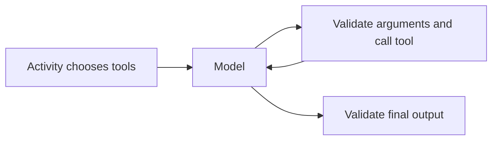

# Tools

```python
from brevia.tools import read_file, save_file

result = await ctx.model().generate(
    instructions="Read the supplied file, save notes.md, then answer.",
    user_text="Analyse contract.pdf.",
    output_type=Report,
    tools=[read_file(request.file), save_file],
)
```

The application chooses which functions a model may call. `generate` keeps asking the
model until it returns a validated result, within the shared run limits. Tools do not
require another runtime or endpoint. A job using tools still restarts its activity
from the beginning after an interruption.



## Read a file

`read_file(*sources, max_chars=20000)` builds a tool restricted to those `FileSource`
objects. Names must be distinct. The model supplies `name`, zero-based `start`,
`count` (default 10), and `offset` (default 0). It never supplies a URL or path.
Brevia uses the same download, file checks and readers as `ctx.files.read`.

The answer contains `sections` with title, page and text, `total`, `truncated`,
`next_start` and `next_offset`. Continue with `start=next_start` and
`offset=next_offset` until `next_start` is null. A large section can span several
answers without losing its tail. `max_chars` bounds returned text, not JSON metadata
or model tokens. Parsed documents are cached within one run, not across runs.

Unknown names and invalid pagination arguments go back to the model for correction.
A file that cannot be read (damaged, encrypted, without text, missing, refused by its
host) and an unsupported format stop the run with their error: the model cannot fix
them. Readers have the same [limits](documents.md) as direct document reading: no OCR,
no PDF table reconstruction, and no XLSX or PPTX reader.

## Save text

`save_file` accepts `name` and `text`, saves UTF-8 bytes among the outputs of the run,
and returns the name, size and SHA-256. The existing `ctx.files.save` rules apply:
no path traversal, atomic publication, and the same name replaces the same file.
For jobs, retrieve it through `GET /runs/{run_id}/files/{name}`. Direct runs do not
have an HTTP file-download operation.

## A tool of the project

```python
from typing import Any
from brevia import RunContext, Tool


async def uppercase(ctx: RunContext[Any], text: str) -> str:
    return text.upper()


tool = Tool(name="uppercase", description="Uppercase a text.", function=uppercase)
```

The function must be async. Its first parameter receives the Brevia `RunContext`;
the remaining typed parameters describe the model's arguments. Types must be
available at runtime, not only under `TYPE_CHECKING`. Return JSON-compatible data
or a Pydantic model. Tool names use 1–64 letters, digits, `_` or `-`; names in a
generation must be unique. `Tool.writes=True` declares external effects; it does not
authorize them or enforce idempotence. The application must make them safe to repeat.
Do not place secrets in descriptions or correctable error messages.

A tool raises `ToolRetry("message")` for arguments the model can correct: the message
goes back to the model, which may call the tool again. Every other exception stops the
generation and the run with its error, also an `InvalidInput` raised by a function the
tool calls.

```python
from brevia.tools import ToolRetry


async def invoice(ctx: RunContext[Any], number: str) -> Invoice:
    if not number.startswith("INV-"):
        raise ToolRetry("number must start with INV-")
    return await load_invoice(number)
```

The parameters after the context must be named: positional-only parameters, `*args`
and `**kwargs` are refused when the `Tool` is created. Each tool has at most `max_attempts - 1` correction retries, and
all model requests and executed tool calls share `RunLimits`. Exhausted retries
raise `OutputInvalid`; exhausted run budgets raise `LimitExceeded`. Schema checking
cannot prove that a tool result or the model's interpretation is correct.

## Records and tests

Brevia records offered names in `model_calls.options.tools`, counts calls in
`model_calls.tool_calls`, and logs tool name, outcome and duration with the run id.
Arguments and results are not added to ordinary logs. There is no separate
`tool_calls` table or global tool registry. The offered names do not version the
function implementations; keep application releases traceable.

The [executable example](analysis-example.md) uses a fake for final answers. A scripted
`fake_model(...)` returns final outputs directly and does not exercise tools. Without
scripted outputs, the schema-generated fake may call tools with synthetic arguments:
use temporary files and harmless functions. Unit tests of the adapter use a simulated
model that requests specific tools, including correction and limit cases.
