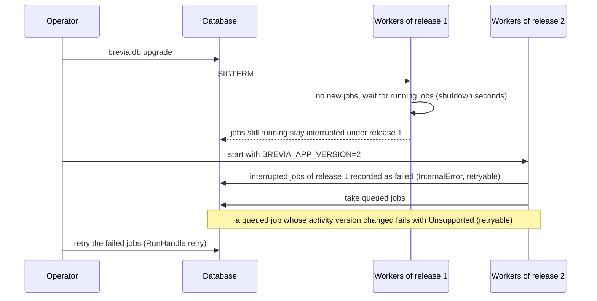

# Operating workers

A worker is the process that runs the [jobs](jobs.md) of an application. An application
whose activities declare the `"job"` mode needs at least one running worker: without
one, submitted jobs stay `queued`.

This page is for whoever deploys the application: how to start and stop workers, how
to release a new version without losing jobs, and how expired data is deleted. How to
submit and follow jobs is in [Running jobs](jobs.md).

## Starting a worker

```sh
BREVIA_APP_VERSION=1.0.0 BREVIA_WORKER_ID=worker-1 brevia worker myproject.app:brevia
```

The worker calls the models, so the provider keys (for example `OPENAI_API_KEY`) must
be in the environment of its process: the providers do not read `.env`. In
development, `uv run --env-file .env brevia worker ...` loads them; in production, the
process manager or the container sets them.

The argument names the [`Brevia`](../reference/application.md#brevia.Brevia) object of the
application, with its activities registered, as `MODULE:NAME`; `NAME` may also be a
function without arguments that returns it. Modules of the working directory can be
imported. Importing the module must not do anything else, such as running jobs or a
server: keep the registration in a module of its own, as `app.py` in the
[example](jobs.md#a-complete-example).

When it starts, the worker:

- starts the application, which connects to the database and checks that the Brevia
  schema and the schema of jobs are migrated (`brevia db upgrade`; a worker never
  migrates them);
- starts again the jobs it was running when it stopped, if it has the same identifier
  and version (see [below](#a-worker-that-does-not-come-back));
- records as `failed` the jobs interrupted under another application version (see
  [Releases](#releases));
- takes queued jobs, up to its concurrency, until it is stopped.

One worker process runs the jobs of one application. The concurrency of a worker limits
the jobs it starts, not the requests to the models: the limits of each run apply inside
each job. To run more jobs at once, raise the concurrency or start more workers, each
with its own identifier.

The command ends with status 2 when the settings are not valid or the application
cannot be loaded, and with status 1 when it stops on a Brevia error, for example
`Unavailable` when the database cannot be reached or a schema is not migrated.

## Settings

The worker reads the same settings as the application (database, project file,
logging; see [Configuration](configuration.md)) and these, from the environment or
`.env`:

| Variable | Default | Meaning |
|---|---|---|
| `BREVIA_APP_VERSION` | the version of Brevia, as `brevia-1.0.0` | Version the worker runs jobs under, at most 100 characters. A job interrupted under a version starts again only on a worker of the same version (see [Releases](#releases)). Set it to tie the [snapshot](runs.md#snapshots) of each job to a release of the application |
| `BREVIA_WORKER_ID` | host name | Stable identifier of the worker, 1 to 100 characters: after a restart, a worker starts again the jobs it was running. Two running workers must never share it, or each would run again the jobs of the other |
| `BREVIA_WORKER_CONCURRENCY` | `4` | Jobs a worker runs at the same time, at least 1 |
| `BREVIA_WORKER_SHUTDOWN_SECONDS` | `30` | Seconds a stopping worker waits for its running jobs, 0 or more |
| `BREVIA_JOBS_SCHEMA` | `dbos` | Schema of the durable state of jobs, different from the Brevia schema (see [Database](database.md)) |

## Stopping a worker

The worker stops on SIGINT or SIGTERM. It takes no new jobs and waits up to
`BREVIA_WORKER_SHUTDOWN_SECONDS` for its running jobs. The jobs still running then are
stopped without recording anything: they stay `running`, and start again from the
beginning of their activity when the worker starts again with the same identifier and
version.

!!! warning "A stop during a job costs its model calls again"
    A job that starts again repeats its whole activity, and its model calls are made
    and paid again (see [Running jobs](jobs.md#starting-again-after-a-stop-of-the-worker)).
    A job starts again at most 3 times, whatever stopped its worker. To let running
    jobs end, give the shutdown wait the duration of the longest job (the
    `max_seconds` of its activity), and let the process manager wait at least as long
    before it kills the process: in a container, the stop timeout of the platform (see
    [Running in production](production.md#start)).

### A worker that does not come back

Give each worker a fixed identifier, such as `worker-1`: a worker starts again only the
jobs that carry its own identifier. The host name, the default, changes when a
container is recreated: the jobs the old container was running would then stay
`running`, with no worker to start them again.

When a worker is removed for good, or restarted with another identifier, the jobs it
was running stay `running`. Cancel them and retry them:

```python
handle = brevia.job(run_id)
await handle.cancel()
await handle.retry()
```

## Releases

A job interrupted under one version starts again only on a worker of the same version,
because its code may have changed. Queued jobs carry no version: a worker of any
release runs them.

The version is `BREVIA_APP_VERSION`, or the version of Brevia when it is not set. The
default is enough for most projects: the code that the job engine resumes is the
workflow of Brevia, which changes only when Brevia is updated, and a change of an
activity is caught by the `version` of its registration, checked when a job starts and
again before an interrupted job runs its activity (a job of another version fails, to
be retried). Set `BREVIA_APP_VERSION`, for example
to the tag or commit of the release, when the snapshots must say which release ran a
job, or when interrupted jobs must never start again on new code of the same
activity version.

To update the application:

1. run `brevia db upgrade`;
2. stop all the workers of the previous release;
3. start the workers of the new release (with a new `BREVIA_APP_VERSION`, if you set it).



- **Queued jobs** are run by the new release. If the version of their activity
  changed meanwhile, they fail with `Unsupported`, retryable, without running: retry
  them, and the input is checked against the new version.
- **Interrupted jobs** of the previous release are not started again on the new code:
  when a worker of the new release starts, it records them as `failed` with a
  retryable `InternalError` whose details name their version, to be retried.

Going back to an earlier release follows the same steps: the version of the workers
that start last is the current one, and they run the queued jobs. The warning of the
job engine at that start, that the version is not the latest, is then out of date. For
the same reason, a worker of the old release restarted during an update becomes current
again: stop all of them before starting the new ones.

Workers of two releases at the same time are not supported: a new worker fails the
interrupted jobs of the old version even if an old worker is still running them.

## Cleanup

Every night at 03:00 UTC, one of the running workers deletes the data expired under
`[traces] retention_days` of the project file; with `0`, the default, contents of
model calls and recorded steps of jobs are kept. With several workers the cleanup runs
once.

- The contents of model calls expired after the end of their run are cleared (see
  [Recorded runs](runs.md#contents-of-model-calls)).
- The recorded steps of jobs ended more than `retention_days` ago are deleted, with
  their input, configuration and prompts, and so are those of earlier cleanups.
  Before that, a job whose record was not updated with its end is reconciled, as when
  it is read, so that it does not stay `running` and can be retried. Jobs that have
  not ended are never touched, so that they can start again.
- With `BREVIA_FILES_ROOT`, the [files of runs](files.md#cleanup) follow their own
  retention: work folders left by a stopped process are removed a day after their last
  change, and the outputs of a run `BREVIA_FILES_RETENTION_DAYS` after the last one it
  saved (never with `0`).

The records of runs and jobs, with their status and usage, and the records of model
calls stay. Without workers, or to clean at another time, run the command, which reads
the database settings and the project file:

```sh
brevia db cleanup --dry-run   # count what would be deleted
brevia db cleanup
```

It prints how many call contents, ended jobs, work folders and output folders it
deleted, or would delete,
and ends with status 1 when the database or the state of jobs cannot be used, or when
folders of files could not be removed.

## Connections

The job engine keeps its own connections to the database, besides the pool of the
application, and a worker opens more of them than a process that only submits and
reads jobs. Count them when sizing the database: see
[Connections](database.md#connections).
